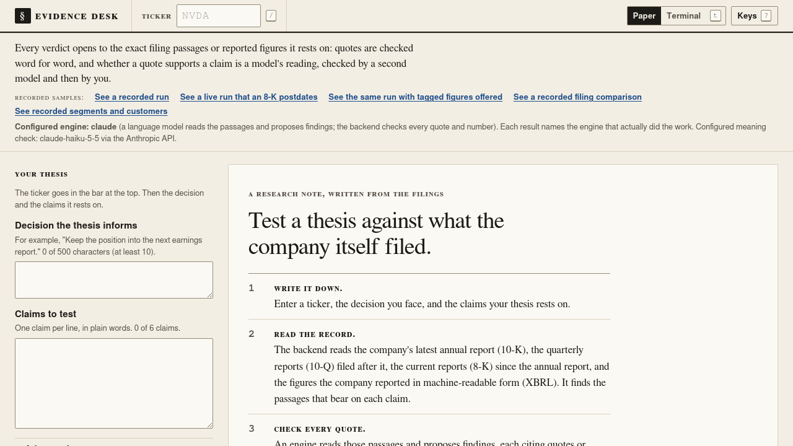

# Evidence Desk

Evidence Desk tests the claims of an investment thesis against a company's own SEC filings. It is for an equity analyst who has to decide whether a thesis still holds after a new filing: you enter a ticker, the decision and the claims; it reads the latest annual report (10-K) and the quarterly reports (10-Q) filed after it, and returns a verdict for each claim with the exact passages behind it. Every quote is verified against the stored filing text on the server before it reaches the page or the Markdown export. When the evidence is thin the brief says **PARTIAL** and gives the reasons.

This is version 2 (tag `capstone-v2`) of the capstone. The plan and the milestones are in [`../README.md`](../README.md), the prompt this version was built from is [`../PROMPT.md`](../PROMPT.md), and the design is in [`ARCHITECTURE.md`](ARCHITECTURE.md).



## Run it

You need Docker running and Make. From this directory, or from the repository root:

```sh
cp .env.example .env   # optional: ANTHROPIC_API_KEY, ANTHROPIC_MODEL, SEC_USER_AGENT
make up                # http://127.0.0.1:8766
make down
```

The app needs the internet to reach SEC EDGAR (`www.sec.gov` and `data.sec.gov`, and nothing else for filings). It works without any key: the deterministic engine quotes the sentences that best match each claim and judges no stance, so every claim reads "passages found, not judged". With `ANTHROPIC_API_KEY`, Claude plans the retrieval queries, drafts findings with a stance and writes the summary; the same quote check applies to everything it returns.

## What you see

1. `make up`, open <http://127.0.0.1:8766>, click **Load example** (five claims about NVIDIA) and **Test the thesis**.
2. The banner shows the status and what was read, each number with its denominator: sources read, passages indexed, claims with verified evidence, findings verified and withheld, quotes verified and rejected.
3. The verdicts come first, one row per claim. Open a claim to read its findings; each excerpt is shown in its surrounding text with the Item of the filing it sits under, the filing it came from, and a link that opens the filing at that passage.
4. The sources table keeps the filing date and the UTC retrieval time in separate columns.
5. **Download Markdown brief** exports the same verified record.

`http://127.0.0.1:8766/?sample` shows a recorded run without starting one. From the command line, `make run ARGS='example'` runs the same pipeline synchronously and writes `results/<run-id>.json` and `.md`; `make demo` drives the live HTTP API end to end and writes `results/demo-<UTC>.md`.

## Measured results (live demo, 17 November 2026)

The record is committed as [`demo/demo-2026-11-17-v2.md`](demo/demo-2026-11-17-v2.md) with its run record beside it.

- **Read from EDGAR:** 3 of 3 filings for NVIDIA (10-Q for the period ended 2026-07-26, 10-Q for 2026-04-26, 10-K for 2026-01-25), 73, 69 and 150 sections, 636 passages indexed. Wall time 3.2 s from request to finished record.
- **Quotes:** 15 offered, 15 verified as exact spans of the stored text, 0 rejected.
- **Verdicts:** 5 of 5 claims "passages found, not judged", so the run is **PARTIAL**.
- **Why not judged:** the Claude engine was configured, but every model call was refused by the API with "credit balance is too low" (HTTP 400). All seven engine steps fell back to the deterministic engine, and the run says so in its errors and coverage limits. **The model-backed path was not exercised live in this version.** It is covered only by tests against a stub client.

## Verification

```sh
make verify       # build, ruff lint and format, node --check, 385 offline tests, live smoke test
make test         # offline tests only (T=tests/test_gate.py for one file)
make fixtures     # record the EDGAR responses used by the tests (REFRESH=1 to overwrite)
make screenshots  # headless Chromium renders the first screen and the sample record into docs/screenshots
```

What the tests cover: request validation and every rejection in the prompt; the EDGAR client (host allow-list, rate spacing, retries, size cap, the filing selection rule) against a mock transport; the filing parser on a recorded NVIDIA 10-Q and 10-K at full size; chunking invariants; BM25 against a brute-force scorer written from the formula; the quote gate (a changed word withholds the finding, whitespace and typographic differences do not, the shown excerpt is always the stored span); the verdict and status rules; the pipeline on recorded filings with a fake EDGAR and a scripted engine (a planted instruction in a passage cannot change a verdict; one failed filing does not erase the others; an engine failure falls back and is recorded); the API, the command line and the Markdown export. The smoke test exercises the running container without the internet.

## Known limitations

- **The model engine was not run live in this version** (see above).
- **Filing structure beyond NVIDIA.** The parser's tests use NVIDIA's filings. A probe of the latest filings of seven other companies on 17 November found Apple, Microsoft, Coca-Cola, Tesla and Amazon split into their Items correctly; **Costco's 10-K was not segmented** (its headings read "Item 1A—Risk Factors", with a dash where the parser expects a full stop) and fell back to one "Full document" section; and **JPMorgan's filings**, which cross-reference Items to pages of an annual report, were left almost entirely under "Cover page". The quote check still holds for these, but the locators are wrong or missing. Neither is fixed in this version.
- **Retrieval is unmeasured.** Passages are ranked by BM25 on the claim's words. There is no golden set yet, so nothing here says how often the passage that matters is in the top eight.
- **A quote can be exact and still not support the statement made about it.** The gate checks that the words are in the filing, not that they mean what the finding says.
- **The page was checked by eye from three screenshots**, not by a user and not in more than one browser. The links that open a filing at a passage were not clicked in a real browser.
- Only 10-K and 10-Q filers. No PDFs, 8-K exhibits, foreign filers or transcripts.
- Runs execute in a worker thread inside the API process; there is no queue and no resume after a restart.
