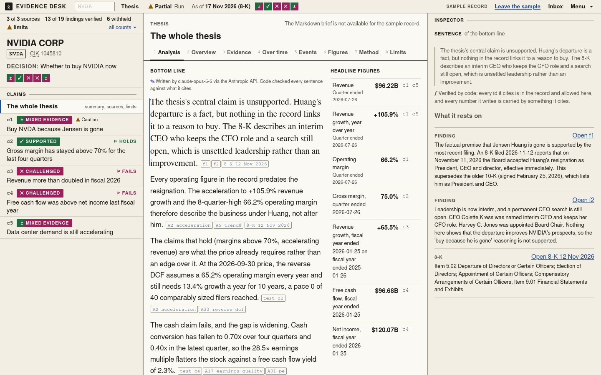
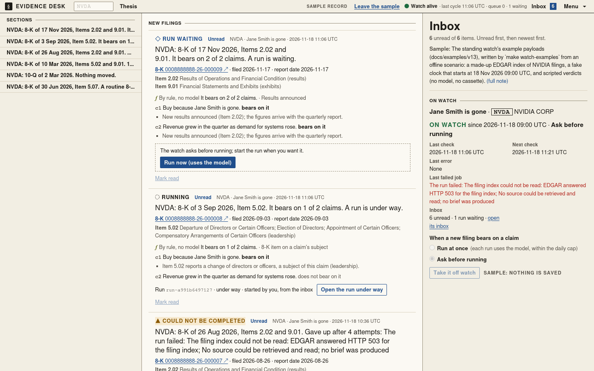
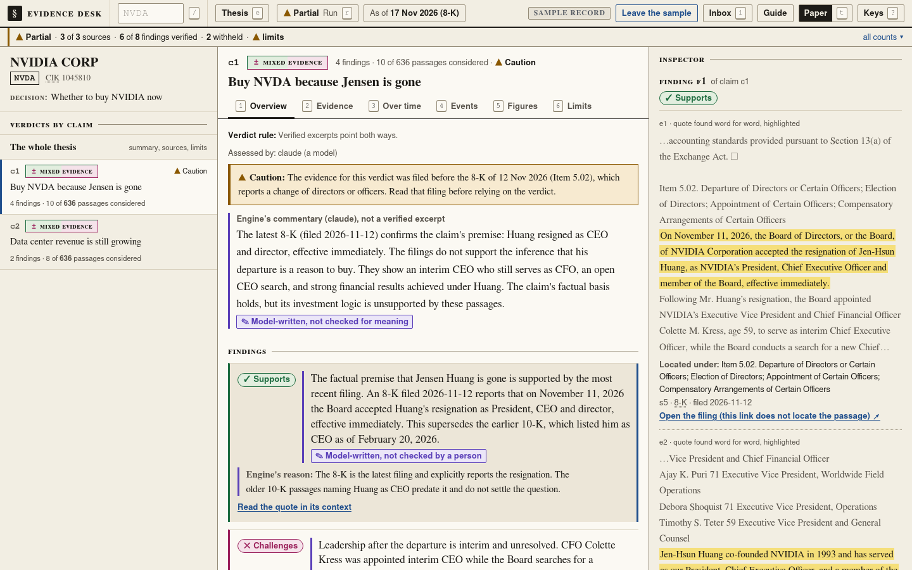
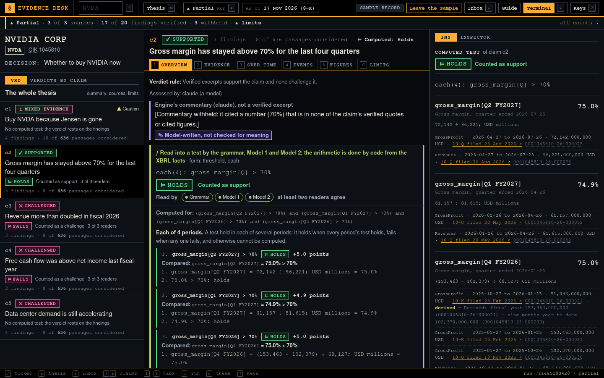
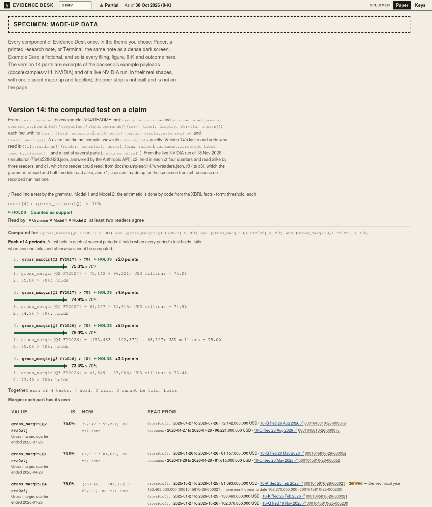
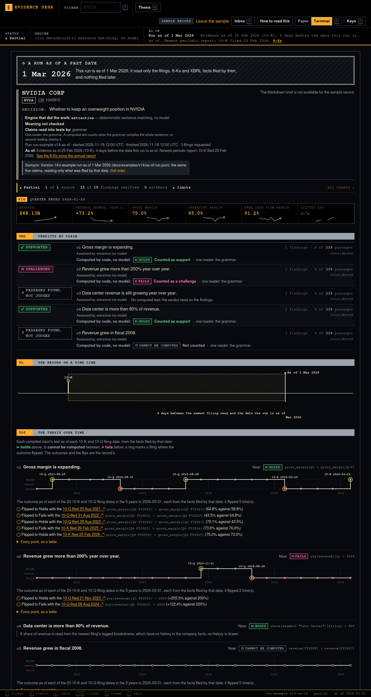
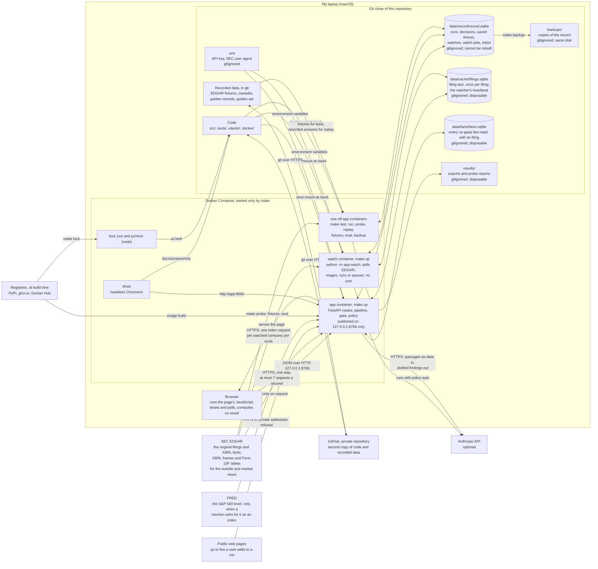

# Evidence Desk

Evidence Desk tests the claims of an investment thesis against a company's own SEC filings. It is for an equity analyst who has to decide whether a thesis still holds after a new filing: you enter a ticker, the decision and the claims; it reads the latest annual report (10-K) and the quarterly reports (10-Q) filed after it, lists the current reports (8-K) filed since the annual report and reads the ones that matter, computes the company's reported figures from its XBRL facts, and returns a verdict for each claim with the exact passages and figures behind it.

Two things are checked mechanically by the backend before anything reaches the page or the Markdown export: every quote is found word for word in a passage that was shown to the engine, and every number in a finding or in its reason is matched to one of its quotes or to a reported figure it cites. A third mechanical check reports, and withholds nothing: a year or fiscal label a finding names that its own evidence does not carry. A fourth check is a model's: a second model, which is not shown the first one's reasoning, reads each finding's evidence and says whether it supports the statement. That is still a model's reading, of the same family as the first, so you accept or reject each finding yourself, and a second verdict follows, by the same rule, from the findings you accepted. A thesis can be saved and run again when a new filing arrives; the page then shows which verdicts moved.

It also shows what a company added, removed and reworded between its two latest annual or quarterly reports, and, under each claim of a run, which of the paragraphs that changed since the filing before share words with that claim or with the search queries the run wrote for it: a reading list for the question the tool exists for, what is new since the last filing. And it reads from a filing's own tagged facts the figures a thesis is usually about and the SEC's company-facts data does not carry: revenue by segment, by product and by geography, and each large customer's share. A run can ask to be offered those figures, so that a finding can cite them.

"Word for word" means a span of the text this tool extracted from the filing, which is not the filing byte for byte: table rows are flattened into lines, zero-width characters are removed, non-breaking and repeated spaces become one space, and a "$" or "%" printed in a cell of its own is joined to its number. A quote is located under the Item and sub-heading the parser found, and it must be whole: one that begins or ends inside a word, or inside a number at a decimal point or a thousands separator, is not accepted, so "46.7" cannot be quoted out of "46.78 billion". Nor may it part a number from what is read with it (since the fixes after 14.2): a quote may not stop between a number and the closing parenthesis, scale word or unit after it ("$46.7" out of "$46.7 billion", "56" out of "56%"), nor begin between a minus, a currency sign or an opening parenthesis and the number ("5%" out of "-5%"). In the Markdown brief, every character of an excerpt that Markdown would act on is escaped with a backslash, so a viewer shows the excerpt as text and an excerpt cannot become a link, an image or a heading. A bare web address inside an excerpt can still be made clickable by a viewer that links addresses on its own.

This is version 14.2 (0.14.2) of the capstone. It adds an analysis to every run ([`docs/analysis.md`](docs/analysis.md)): the figures that bear on each claim and what an analyst would work out from them, computed by code; corollaries a model proposes ("if this claim were true, what else would be?") and code computes; an outside view (base rates and peer standing across SEC filers, [`docs/outside-view.md`](docs/outside-view.md)) and a market view (valuation and what the price implies, [`docs/market-view.md`](docs/market-view.md)), both read from a reference pack shipped with the app ([`docs/reference-pack.md`](docs/reference-pack.md)); and an argument a model writes per claim and for the thesis, every sentence of which code audits against what it cites. The page is a workspace that fills the window and opens on that analysis, with a Method tab that draws the run's stages, who did each (code or a model) and how long it took ([`docs/design.md`](docs/design.md)). Version 14.1 (0.14.1, tag `capstone-v14.1`) answered a fifth hostile reading, of version 14, finding by finding ([`docs/referee-5-triage.md`](docs/referee-5-triage.md)): a run's summary no longer contradicts its verdict table, a computed test prints the comparison it made, the brief says who read each computed test, the number check catches three more wrong numbers, the restore check tells a backup that is behind the record from one that is wrong, and where every model answer came from is stated in one place ([below](#where-the-model-answers-came-from)). Version 14 (0.14.0, tag `capstone-v14`) gives every reported fact the date it was filed ([`docs/facts.md`](docs/facts.md)): a run can be as of a past date and then reads only what had been filed by then, every fact the app reads is kept in a fact store, and a company's restated values are listed with both filings. It also turns a claim such as "Gross margin is expanding" into a test computed from those facts, with the arithmetic and the outcome as of each filing of the last five years, and counts the outcome in the claim's verdict ([`docs/claim-tests.md`](docs/claim-tests.md)); a claim it cannot turn into a test says why and is judged as before. Version 13 (0.13.0, tag `capstone-v13`) added the standing watch: a saved thesis can be put on watch, a second process reads the company's filing index every 15 minutes, decides by rule which claims a new filing bears on, and either runs the thesis again or leaves the run waiting in an inbox on the page ([`docs/watch.md`](docs/watch.md)). Version 12 (tag `capstone-v12`) dates a run's evidence and reads what the company reported since its annual report: every 8-K filed after it is listed, the ones after the newest quarterly report and those on a substantive subject are read and split into their items, a claim on such a subject is offered the matching sections, and a finding that a later 8-K on its claim's subject postdates is marked so ([`docs/events.md`](docs/events.md)). It was built after a run answered "buy NVDA because Jensen is gone" from an annual report in which he is chief executive. Version 8 listed, under each claim of a run, what changed in the filings ([`docs/claim-changes.md`](docs/claim-changes.md)). Version 9 read revenue by segment, product and geography and customers' shares from each filing's own tagged facts ([`docs/breakdowns.md`](docs/breakdowns.md)). Version 10 lets a finding cite those figures ([`docs/tagged-figures.md`](docs/tagged-figures.md)), answers a third hostile reading ([`docs/referee-3-triage.md`](docs/referee-3-triage.md)), and fixes three faults in the reported figures that testing on few companies had hidden ([`docs/evidence/figures-eight-companies.md`](docs/evidence/figures-eight-companies.md)). Version 11 reports a year a finding names that is nowhere in its evidence, and measures what that check catches ([`docs/period-check.md`](docs/period-check.md)); it also answers a sixth blind review, of the system: a restore check that compares every record, the app and a one-off container writing one record at once, and a live run timed stage by stage. Version 11.1 answers a fourth hostile reading, finding by finding ([`docs/referee-4-triage.md`](docs/referee-4-triage.md)): a quote may no longer begin or end inside a word or a number, the restore check compares every column of the record, the Markdown brief escapes whatever Markdown would act on, and two published speed figures that had been measured wrongly are corrected. The plan and the milestones are in [`../README.md`](../README.md), the design is in [`ARCHITECTURE.md`](ARCHITECTURE.md), and the tests are described in [`docs/testing.md`](docs/testing.md).




A run opens on its analysis: the argument a model wrote (the sample above was answered by claude-opus-5-5 through the Anthropic API), each sentence followed by a chip for every finding, figure, computed test or 8-K it cites. Selecting a sentence or a chip reads what it rests on in the inspector, down to the formula and the filings. Code audits every sentence; one it could not verify is shown, marked, with the reason.

The page is a research note read in a workspace that fills the window, in two themes over one frame: Paper, a typeset note, and Terminal, a dense dark screen (the switch in the bar, the `t` key, or your system's setting). The claims are listed once, in the rail at the left; selecting one (or the whole thesis) shows it in the centre pane under tabs (Analysis, Overview, Evidence, Over time, Events, Figures, Method, Limits; a record made before runs kept an analysis has no Analysis tab), and whatever you pick there (a finding, a computed test, an 8-K, a figure) is read in the inspector at the right. The panes scroll; the page does not. Who did the work (the engine, the checker, the readers, the run's id and times), the guide and the marks are in the Run drawer, opened from the status chip in the bar. `/` focuses the ticker, `e` opens your thesis beside a result, `j` and `k` move through the claims, `1` to `8` show a tab, `r` opens the Run drawer, a code typed after a full stop in the ticker field goes to that panel (`.fig`, `.evt`), `?` lists the keys, and printing lays the whole note out as a document. On a phone it is one column with the tabs kept in view. `?sample=run-events` shows a live NVIDIA run of 18 November 2026, answered by the Anthropic API, whose first claim an 8-K postdates. The design and every component are described in [`docs/design.md`](docs/design.md); `/specimen.html` shows each one on made-up data.


## Run it

You need Docker running and Make. From this directory, or from the repository root:

```sh
cp .env.example .env   # optional: ANTHROPIC_API_KEY, ANTHROPIC_MODEL, SEC_USER_AGENT
make up                # http://127.0.0.1:8766, and the watcher beside it
make down
```

- **Without any key** the app works on real filings: the deterministic engine quotes the sentences that best match each claim and judges no stance, so claims read "passages found, not judged". **Reported figures only** needs just a ticker.
- **With `ANTHROPIC_API_KEY`** Claude plans the retrieval queries, drafts findings with a stance and writes the summary. The same checks apply to everything it returns. It answered through the API once at version 1 (22 October) and again from 18 November, when credit was added; on 17 November both keys were refused for lack of credit. Which results the API answered and which a stand-in's recordings answered is in one place: [Where the model answers came from](#where-the-model-answers-came-from).
- **Without the network or a key** you can still see a judged run: open <http://127.0.0.1:8766/?sample>, or run `make replay`. <http://127.0.0.1:8766/?sample=changes> shows a recorded comparison of NVIDIA's two latest annual reports, and <http://127.0.0.1:8766/?sample=breakdowns> the tagged breakdowns of the latest one. <http://127.0.0.1:8766/?sample=run-tagged> is the same thesis recorded again with the tagged figures offered to the engine. Both use three recorded NVIDIA filings and model answers replayed from a cassette ([`docs/cassettes.md`](docs/cassettes.md)).
- **Model readers of each claim** (off by default; a key or a cassette): `make up READERS=models` or `make run READERS=models ARGS='example'` turns on two model readers beside the grammar for that command only (`model` for one, `grammar` for none). Without `READERS`, `EVIDENCE_DESK_CLAIM_READER` in `.env` decides, and `READERS` never changes `.env`. `make readers-check` tests both ways inside the containers ([`docs/claim-tests.md`](docs/claim-tests.md)).
- **With the network and no key**, `make up-recorded` starts the app with those recorded answers: **Load example**, then **Test the thesis**, gives the judged run on filings fetched live, and you can review it and save it. This works while NVIDIA's reported facts are as they were on 17 November 2026; after its next filing the prompts will no longer match the recording, and the run will fall back to the keyless engine and say so.

## What you see

1. Click **Load example** (five claims about NVIDIA) and **Test the thesis**.
2. The banner gives the status and what was read, each number with its denominator.
3. The verdicts come first, one row per claim, each naming the engine that assessed it. A legend on the page says what every mark means.
4. The reported figures follow: the newest quarter and the newest fiscal year, each figure opening to its arithmetic and the reported facts it used, with charts over time.
5. Open a claim to read its findings. Each excerpt is shown in its surrounding text with the Item of the filing it sits under and a link that opens the filing at that passage. Each finding lists its checks: the quote was found, the numbers matched, the years it names are in its evidence, and whether its meaning was checked.
6. **Accept** or **Reject** each finding, with a note if you like. The rail shows two verdicts per claim: the engine's, and the one that follows from the findings you accepted. Undecided findings do not count toward yours.
7. **Save this thesis**, and later **Run again on the latest filings**. **What moved** compares the two newest runs: which verdicts changed, which excerpts are new, which filing is new.
8. **Download Markdown brief** exports the verified record, followed by the reading list of item 9, set apart; once every finding is decided, **Download reviewed brief** includes your decisions.
9. **Changed since the previous annual and quarterly report**, under each claim, lists the paragraphs that were added, removed, reworded or changed in their figures between the newest annual report and the newest quarterly report the run read and the filing of the same form before each, when they share at least two words with the claim or with the search queries the run wrote for it: ranked by BM25 against the claim and those queries, the five best, each linked into its filing. An older quarterly report the run read is not compared, and the earlier filing of a pair may be one the run did not read. It is a reading list. No model chose or judged these, none counts toward the verdict, and the block is marked as a keyword match that nobody has checked.
10. **What changed in the filings** needs only a ticker. It compares the latest annual report with the one before it (or the latest quarterly report with the previous one), Item by Item: how many paragraphs are unchanged, changed only in their numbers, reworded, added and removed, with short lines and table rows counted apart. Under each Item it names the sub-headings found in only one filing and lists the paragraphs, each linked into its own filing: the added and the removed ones, the reworded ones with the changed words marked, and those whose figures alone moved with the figures marked.
11. **Segments and customers (tagged facts)** needs only a ticker too. It reads the latest annual or quarterly report's own tagged numbers into tables: revenue by business segment, by product or service and by geography, and customers' shares of revenue, each with its change from the year before and a line saying whether the members add up to the filing's tagged total. The labels are made from tag names and are not the company's own. The view reads the latest filing when asked and is tied to no run.
12. **As of** under the run's details says how old the evidence is: the newest filing read, its date and how many days before the run, and the newest periodic report. **Since the annual report** lists every 8-K the company filed after the annual report the run read, newest first: its items with their SEC titles and categories, and for the 8-Ks read the opening sentences of each item, linked to the filing, and the roles an Item 5.02 names. A line counts how many were read, could not be read, were left by the cap, and were routine and listed from the index only. A claim on a subject an 8-K can report (a change of officers, an accounting problem, a deal, and so on) gets a caution when its verdict rests on a finding filed before such an 8-K, or a note saying that none was filed since the annual report up to the newest filing read. Neither changes a verdict. `make events T=NVDA` prints the same list for any company.
13. **Computed tests**, in the Markdown brief and on each claim of the run record (`Claim.computed`): a claim that compiles to a test shows the test, the periods it was computed for, the arithmetic from the reported facts with each filing, whether it holds, and a table of the outcome as of each 10-K and 10-Q filing date of the last five years, with the flips marked. A test that holds counts as support in the verdict, one that fails as a challenge, one that cannot be computed as nothing, with the reason. A claim that does not compile says why. The arithmetic is never a model's. Which test a claim becomes depends on the readers: with the grammar alone (the default) it is a fixed rule and no model is involved; with one model reader (`READERS=model`) a test counts only when the grammar and the model read the same one; with two (`READERS=models`) a test counts when two of the three read it alike, so the two models can decide it without the grammar, and a wrong reading they share sets a verdict (set C's judge found one such, h063). The brief says which of the three a run used, and the record names every reader of every test (`Claim.readings`, `ComputedTest.read_by`). The Markdown brief's verdict table has a column for what each claim's test gave and whether it was counted. The page draws them (below); the payloads are in [`docs/examples/v14/`](docs/examples/v14/README.md).
14. **As of a past date**: `make run ARGS='run --ticker NVDA --decision "..." --claim "..." --as-of 2026-03-01'` (or `as_of` in `POST /api/runs`) reads the newest 10-K filed by then, the 10-Qs and 8-Ks after it up to the date, and only the facts filed by the date. `make restatements T=NVDA` (or `GET /api/companies/NVDA/restatements`) lists every period whose value changed between filings.
15. **Also offer the figures tagged in the filings**, a checkbox under Advanced, asks a run to show the engine those segment, product, geography and customer figures for the newest annual and quarterly report it read, so that a finding can cite one. They appear in the figures panel as a group of their own, and a finding that rests on figures alone, with no excerpt, says so beside its stance. It is off by default because it changes what the model is shown.
16. **The analysis** (version 0.14.2; the page draws it on its Analysis tab, where a run opens, with the headline figures and a Method tab: [`docs/design.md`](docs/design.md)), on the run record (`Run.analysis`, `Claim.analysis`) and in the Markdown brief. Code decides which measures bear on each claim and why, and the headline is the figures the claims are about; the other reported figures stay on the record, listed as tied to no claim. Under each claim, analytics computed by code, each answering a stated question on the claim's own basis: a fiscal-year claim gets the fiscal years and what has happened since, a test of one measure against another the gap reading by reading and the walk from net income to free cash flow, a claim that names a part of the business the part's growth against the company's (from the tags of the filings the run read) and which parts drove growth; and, where they bear, cash conversion, receivable and inventory days, stock compensation and capital expenditure against revenue, deferred revenue and return on equity. Each has its formula, its inputs with their filings and one sentence written by code; none is computed for the thesis at large. A run that can reach EDGAR adds the outside view (how often a claim's test has been true of other filers of the company's size and industry and whether it lasted; where the company ranks in its industry) and the market view (price to earnings, the free cash flow yield and the growth the last quarter-end price implies, for the thesis as a whole), each within a time budget; one that runs out or gets no answer is named on the record with why. Both read a reference pack shipped with the app (`src/app/reference`, built by `make reference-pack`, [`docs/reference-pack.md`](docs/reference-pack.md)) before they ask EDGAR, so a fresh host has them at once. A run records how long each of its stages took (`Run.timings`). The odds a quarterly test holds in each of the next four quarters, by resampling its own history, with what that number is not. With a model: corollaries it proposes ("if this claim were true, what else would be?") and code computes, and an argument (is the premise true, does it carry the decision, the case for and against, what would change the verdict, the thesis's weakest link, bottom line and scenarios) in which every sentence cites the record and is audited by code, an unverified one kept and marked. Without a model the record carries the computed part, says so, and adds one line to the run's errors. It never changes a verdict. One model request for the corollaries, one per claim for its argument (several at once) and one for the thesis (`ANTHROPIC_ANALYSIS_MODEL`); a claim whose request fails has no argument and says why. [`docs/analysis.md`](docs/analysis.md); payloads in `docs/examples/analysis/` (`make examples-analysis`).


**The standing watch** (version 13). A saved thesis can be put on watch (`PUT /api/theses/{id}/watch`). The watcher, a second container started by `make up`, reads the company's filing index on EDGAR every 15 minutes; for each new 10-K, 10-Q or 8-K it decides by rule, without a model, which claims it bears on, and either runs the thesis again and says what moved, or leaves the run waiting for you (policy `ask`, the default; `auto` runs at once, at most five times a day). The inbox (`GET /api/inbox`) says what arrived and why it matters or does not. `make watch-status` says whether the watcher is alive; `make watch-once` does one cycle by hand. How it decides, what it costs and where it is wrong: [`docs/watch.md`](docs/watch.md); every payload: [`docs/examples/v13/`](docs/examples/v13/README.md). On the page, a saved thesis has its watch (put on, policy, taken off, with the last and next check and the last error), the bar has the inbox (`i`) with its unread count and the watcher's health, and the inbox gives each new filing its kind, the filing, the reasons per claim, what moved and, for a waiting run, a "Run now (uses the model)" button. <http://127.0.0.1:8766/?sample=inbox> shows the example payloads, copied unedited.



**Computed claims, dates and restatements** (version 14). On a run, each claim that compiles to a test shows it on its Overview before the findings: the test, whether it holds, fails or cannot be computed (and why), what the verdict counted and the margin, with every value, the facts and filings it was read from and the arithmetic read in the inspector. The rail and the claim's Overview say, claim by claim, which part of the verdict is computed (by code, from the test the readers agreed on) and which is the engine's reading of the filings, who read the claim into its test, and how many readers agreed ("Read by the grammar, Model 1 and Model 2; computed by code", "3 of 3 readers"): the label says "no model" only when the grammar alone read the claim. After a model's summary, the line the code writes naming the verdicts the computed tests set or changed afterwards (`verdicts_after_summary`) follows directly, marked as written by code. Each test has one mark per reader (the grammar and up to two models): ● read this test, ≠ read another test, ○ read no test, with what it read or why it refused on hover or focus, and the record's agreement ("at least two readers agree", "counted, with one dissenting reading", "not counted: no two readers agree"). A test held in each of several periods, or two tests joined by "and", shows every part with its own sides, arithmetic and outcome, and how they came out together. On the Over time tab, under the time line, **the thesis over time** follows each test over every 10-K and 10-Q filing date of five years, the flips ringed and named. The drawer has an **As of** date: a run as of a past date opens with a banner and ends its time line at that date, on screen and in print. **Restated values**, a lookup beside the others, lists every period a later filing reported differently, with both filings and the change. <http://127.0.0.1:8766/?sample=run-live>, the first sample on the first screen, is a live NVIDIA run of 18 November 2026 answered by the Anthropic API (claude-opus-5-5 reading, claude-haiku-5-5 checking) and read into tests by the grammar, claude-haiku-5-5 and claude-sonnet-5-5, copied unedited from `results/run-7fa4a528d428.json`: three of its five claims became tests all three readers read alike (one held in each of the last four quarters), and no reader could read the other two. `?sample=readers` is the backend's example with two model readers (`docs/examples/v14/run-readers.json`, their answers replayed from a cassette recorded through the API), where the grammar refused three claims both models read alike. `?sample=computed`, `?sample=as-of` and `?sample=restatements` show the backend's other example payloads ([`docs/examples/v14/`](docs/examples/v14/README.md)), made offline with the extractive engine (no model, no cassette) and copied unedited by `make sample-v14`.









From the command line, `make run ARGS='example'` runs the same pipeline and writes `results/<run-id>.json` and `.md`; `make changes ARGS="NVDA --form 10-K"` writes the filing comparison. `make probe TICKERS="AAPL COST"` reports how well a company's filings split into their Items, and `make figures TICKERS="COST AMZN"` prints each company's quarters as a run would see them.

## The system



**Where each part runs.** Everything runs on one laptop. The served backend is one container; the watcher is a second one, from the same image, sharing the data directory and listening on no port. The page's JavaScript runs in the browser, not in the container that serves it. `make test`, `run`, `probe`, `replay`, `fixtures`, `eval` and `backup` each start a separate short-lived container from the same image; these bypass the served app, and the ones that read filings reach EDGAR themselves. Nothing listens beyond `127.0.0.1`.

**How code reaches it.** The repository is mounted into every container, so the running code is the working tree: the image holds only the dependencies, and a changed file is served without a rebuild (the page's files at once, Python code when the app is next started). `jscheck` mounts the tree read-only. The app, the one-off containers, `lock` and `shots` mount it read-write; `shots` is a third-party image (headless Chromium), and what it writes is the screenshots and the page dumps. Dependencies are installed when the image is built, from PyPI and the container registries, never while it runs. The only other copy of the code is the private GitHub repository, reached by `git push` over HTTPS.

**How data reaches it.** Filings and XBRL facts come one way from SEC EDGAR over HTTPS; nothing is written to EDGAR. A user may add up to five public pages to a run, fetched with private addresses refused. With a key, passages go to the Anthropic API as data and drafted findings come back.

**What cannot be rebuilt.** The storage is split along that line: a record that is backed up, and a cache that can be deleted.

| Data | Can it be rebuilt? | Copies |
| --- | --- | --- |
| Run records, decisions on findings, saved theses: `data/record/record.sqlite` | **No.** A run's inputs move: the facts feed changes with every filing and restatement, the list of "latest" filings moves, the parser changes, and a model does not repeat itself. A decision is a person's and exists nowhere else | The laptop, and `backups/` on the same disk (`make backup`, checked by `make restore-check`). **No copy off the laptop** |
| Filing text: `data/cache/` | Yes, from EDGAR, but only by the parser version that produced it, which after a change to the parser exists only in the commit that ran it. A stored run's quotes are spans of that text and are not checked again when it is rebuilt by a newer parser | The laptop; disposable |
| The database of version 3: `data/runs/runs.sqlite`, where it survives | No. It is not read by later versions (the app logs once that it found it) and not backed up | The laptop |
| Facts with their filings: `data/facts/` | Yes, from EDGAR (`make facts-load`) | The laptop; disposable |
| The facts feed and the list of filings, as they were | No: EDGAR serves their current state | EDGAR |
| Recorded fixtures and golden records | Only as a new baseline: recording again gives different facts and moves the tripwire | Laptop and GitHub |
| The cassette of model answers | No | Laptop and GitHub |
| `results/` | Disposable. One copy; what is worth keeping is copied into `demo/` or `docs/` and committed | The laptop |
| Keys in `.env` | Yes, reissued by the provider | The laptop |

## The outside view and the market view

Two things a company's own filings cannot say, computed on demand and not yet part of a run
(`docs/outside-view.md`, `docs/market-view.md`; an example on recorded SEC data, read offline, is
in `docs/examples/market/`):

- **How often has this been true of others?** `make outside-view T=NVDA CLAIM="Revenue grew more
  than 50% year over year"` compiles the claim to a test and counts it over SEC's XBRL frames: among
  other filers of the company's size and among its industry, in how many company-years it held, and
  in how many of those it held again a year later, with the nearest cases by name; then the
  company's rank among its industry on the measures the claim names.
- **What does the price need?** `make market-view T=NVDA` reads a price from SEC itself (no account, no key):
  the value of a Form 13F manager's position divided by the shares it holds, at a quarter's end.
  That is the manager's own valuation, assumed to be the day's close and never compared with an
  exchange; the issuer is matched by name, not by ticker. It is used only when a second
  manager's filing gives the same price within 0.5%; otherwise there is no valuation, with the
  reason, values the company at it, and solves for the revenue growth the price needs under
  printed assumptions, set beside what filers of its size actually did over ten years. `PRICE=...
  PRICE_DATE=...` gives your own price instead; `AS_OF=YYYY-MM-DD` reads either view as of a day.
  It is arithmetic under assumptions, not a forecast and not advice.
- `make market-check` runs both on the eight probe companies; `make market-probe` asks every outside
  source once and reports what came back; `make fixtures-market` and `make market-examples` record
  and rewrite the example. Over HTTP: `GET /api/companies/{ticker}/outside`, `/market`, `/analytics`.

There are no daily prices: no source of them may be read by a script, so the stock's move after an
8-K is computed only from closes you supply (`docs/market-view.md`).

## Where the model answers came from

This is the one place that says it; every other mention points here. A model-backed result in this repository was answered in one of two ways, and each recorded answer's envelope names its channel in `via` and its model in `model`.

| Answered by | When | What it answered | Where it is |
| --- | --- | --- | --- |
| A stand-in: Claude Sonnet 5.5 for the engine's prompts and Claude Haiku 5.5 for the meaning check's, each a Claude Code subagent given the exact prompt, because the Anthropic API refused every call from this project for lack of credit | 17 November 2026 | The example thesis, recorded three times (`?sample`, `?sample=run-tagged`, `make replay`); the golden set's plans, assessments and meaning checks; the 152 planted mismatches. So: the first four rows of the table below, the verdicts and the meaning check in [`eval/README.md`](eval/README.md), and every replay | `demo/cassettes/nvda-example` (12 answers from the stand-in; the cassette now holds 26, the other 14 recorded through the API for the analysis, see the last row), `-plain` (12), `-tagged` (12), `eval/cassettes/golden` (79), `eval/cassettes/mismatch` (64) |
| The Anthropic API, with the full analysis | 19 November 2026 (UTC) | Two live runs, NVIDIA (run-8a12ef614117) and Costco (run-72359824897a): `claude-opus-5-5` read the filings, proposed the corollaries and wrote the argument, `claude-haiku-5-5` checked meaning, and `claude-haiku-5-5` and `claude-sonnet-5-5` read each claim into a test beside the grammar | `src/web/sample-run-live.json` (`?sample=run-live`) and `sample-run-costco.json` (`?sample=run-costco`), copied unedited from records in the gitignored `results/` |
| The Anthropic API, after credit was added | 18 November 2026 | Two live NVIDIA runs, each with `claude-opus-5-5` reading the filings and `claude-haiku-5-5` checking meaning: `?sample=run-events` (run-39d0b17b5396) and run-7fa4a528d428 (which also had `claude-haiku-5-5` and `claude-sonnet-5-5` reading each claim into a test; it was the page's `?sample=run-live` until the run of 19 November replaced it). The two model readers on set C (240 answers) and on the example run with two model readers (12 answers) | The runs: `src/web/sample-run-events.json`, copied unedited from a record in the gitignored `results/` (the other is no longer a sample). The readings: `eval/cassettes/claim-readers` (252 answers, 126 per model) |

Of the analysis of version 0.14.2, the corollaries (`propose`) and the argument (`analyse` per claim, `conclude` for the thesis) are recorded for both examples (claude-opus-5-5, through the API, 18 and 19 November 2026 UTC; 14 requests for the recording that stands, after earlier ones the API refused or truncated). `make examples-analysis` writes `docs/examples/analysis/run-model-argument.json` and its brief from them: 109 sentences written, 106 passed the audit, 7 of them restating a threshold (the count is the same under the audit's rule before and after the fixes that followed 14.2). `run-hand-built-argument.json` shows every shape with answers scripted by code, no model; it is not an example of an argument. The page's first two samples (`src/web/sample-run-live.json`, NVIDIA, and `sample-run-costco.json`, Costco) are live runs of 19 November 2026 UTC through the API with all three readers: 105 sentences written and 101 verified in 123 seconds, and 92 written and 85 verified in 126 seconds. `make record-analysis` records only what a cassette lacks.

Not answered through the API: the judge of set C (Claude Sonnet 5.5 as a Claude Code subagent), the reviews and the referees (Claude Code sessions), and the drafting of the golden set and of the foreign claim sets. Nothing recorded by a stand-in has been recorded again through the API, so the numbers in the first group are still a stand-in's; the engine of the live runs (`claude-opus-5-5`, the app's model) is not the stand-in that answered the recordings (Claude Sonnet 5.5).

## Measured results, in brief (17 and 18 November 2026)

Every number has the command that produced it and its denominator in [`docs/results.md`](docs/results.md); outputs that are not otherwise in the repository are under [`docs/evidence/`](docs/evidence/).

| What was measured | Result | Full account |
| --- | --- | --- |
| The example thesis, recorded three times: five claims about NVIDIA, three filings (`make replay`) | First recording: complete, 18 of 18 findings verified, 18 of 18 quotes found word for word, 25 numbers checked and none unmatched. The same prompts recorded again with no reminder of the rules: again 18 of 18, 22 numbers and none unmatched, and a different verdict on one claim of five. With the tagged figures offered: 18 of 19 findings verified, one withheld for a number it did not cite | [`docs/results.md`](docs/results.md), [`demo/cassettes/`](demo/cassettes/) |
| Retrieval on the 30-case golden set (`make eval`) | The passage that must come back is among the eight shown for 9 of 24 answerable cases with the claim's own words, 18 of 24 with the planner's queries | [`docs/retrieval.md`](docs/retrieval.md) |
| Verdicts on the golden set | Agree with the expected stance in 20 of 24; no reversal; 6 of 6 unanswerable claims refused; 84 of 84 quotes found | [`eval/README.md`](eval/README.md) |
| The meaning check | Rejected 1 of 78 real findings and changed no verdict. Rejected 150 of 152 planted mismatches and accepted none | [`eval/README.md`](eval/README.md) |
| Reported figures against an answer key | 28 published values for Apple, Microsoft and NVIDIA match | [`docs/results.md`](docs/results.md) |
| Reported figures on eight companies (`make figures`) | Three faults found and fixed on 17 November: Costco's 16-week quarter was never derived, Amazon's trailing twelve months were taken for fiscal years, JPMorgan had no revenue. After each fix only that company's lines moved | [`docs/evidence/figures-eight-companies.md`](docs/evidence/figures-eight-companies.md) |
| Filings split into their Items (`make probe`) | 13 of 14 filings of eight companies; JPMorgan's quarterly report not | [`docs/results.md`](docs/results.md) |
| What changed between two filings (`make changes`) | Runs on eight companies' annual reports. NVIDIA: 251 paragraphs unchanged, 60 changed in figures only, 218 reworded, 133 added, 132 removed | [`docs/filing-changes.md`](docs/filing-changes.md) |
| Changes that bear on each claim | 802 changed paragraphs behind the example; per claim, those sharing at least two words with the claim or its queries, ranked by BM25, the five best listed. Nobody has judged the lists | [`docs/claim-changes.md`](docs/claim-changes.md) |
| Tagged breakdowns (`make breakdowns`) | On sixteen filings of eight companies every breakdown adds up to the filing's tagged total. NVIDIA's are checked against the filing's own text | [`docs/breakdowns.md`](docs/breakdowns.md) |
| Tagged figures offered to the engine (`make replay` on two recordings made the same day) | Five verified findings cite one, and citations of figures go from 8 to 20. Not shown: that the option changes a verdict. Asking the same prompts again moved a verdict too | [`docs/tagged-figures.md`](docs/tagged-figures.md) |
| 8-Ks split into their items (`make events-probe`, 18 November) | Every 8-K of the last 12 months of eight companies: 190 of 200 listed items found before two fixes (Coca-Cola's "Item 9.01(d).", JPMorgan's "Item 5.02(e)"), 200 of 200 after | [`docs/events.md`](docs/events.md), [`docs/evidence/`](docs/evidence/) |
| Which claims an 8-K bears on (`make event-categories`) | On 84 claims labelled before the rule existed (39 with no category): precision 0.90 and recall 0.92 on the first score; 0.94 and 1.00 after one tuning pass on the same claims, so fitted. Three false alarms remain | [`docs/events.md`](docs/events.md) |
| NVIDIA's 8-Ks, live (`make events T=NVDA`, 18 November) | 12 since the annual report of 25 February, 8 read. The 8-K of 12 November, Item 5.02, reports the resignation of Jen-Hsun Huang as President and Chief Executive Officer | [`docs/evidence/events-nvda.txt`](docs/evidence/events-nvda.txt) |
| Claims compiled to tests (`make claim-labels`, 18 November) | 150 of 150 development claims compile exactly to their labelled test or to "none", on the first scoring and the last; 60 of 60 held-out claims, both times it was scored. Labels and grammar have one author, a Claude session, so this says the grammar covers that author's phrasings and nothing about anyone else's. After rule 3 (below), 147 of 150: d040, d043 and d121 (and h050, held out) expect the fiscal-year default the rule refuses; the labels were not changed | [`docs/claim-tests.md`](docs/claim-tests.md) |
| Claims another model wrote (`make claim-foreign`, 18 November) | Of 40 held-out numeric claims written by Claude Sonnet 5.5 without seeing the grammar: 8 compiled to the right test, 11 to a wrong one, 21 not compiled (7, 15 and 18 before the grammar was changed on the other half). None of 37 non-numeric claims compiled. Then all 120 became development material and a claim compiles only when its test explains every word: of 83 numeric claims, 23 right, 0 wrong, 60 refused (22, 11, 50 before). The judge was the grammar's author, and the rule was written with these claims open. On a fresh set B of 120, scored once: of 80 numeric claims, 5 right, 1 wrong, 74 refused; none of 40 non-numeric claims compiled. With both sets then development material, after the measure catalogue and the forms taken from their refusals (each of N periods, a change over a span, two measures compared, two tests joined by "and", a share for a named year): set A 42 right, 0 wrong of 83; set B 23 right, 0 wrong of 80, by the same judge. After rule 3 (made after set C: a flow against an amount in a sentence that names no period is refused), 39 and 22: it takes away f048, f091, f095 and g106, each judged right before as the latest fiscal year | [`docs/claim-tests.md`](docs/claim-tests.md) |
| Claims read by three readers (set C, 18 November, `make eval ARGS='claim-readers --set eval/claim-tests-foreign-c.json --record --max-calls 250 --judge'`) | 120 new claims by Claude Sonnet 5.5, read once by the grammar and two model readers through the Anthropic API (240 calls, Haiku 5.5 and Sonnet 5.5, recorded). Of 80 numeric claims a test was read by the grammar for 19, by Haiku for 37, by Sonnet for 36; at least two readers agree, so the test counts, on 36 (19 all three, 17 the two models alone); readings differ on 1; none of 40 not-numeric claims was read. Judged by Sonnet 5.5 shown only the judge's file: 33 right, 1 wrong (h063, an annual amount tested on a quarter), 2 unsure (the file did not explain `each` or `change`; it now does). Sonnet 5.5 wrote the claims, is a reader and is the judge; a second Claude model agreed. 43 numeric claims got no test, 16 of them for an approximate figure and 9 for a measure the tool lacks. Rule 3 came after and is not in these numbers | [`docs/claim-tests.md`](docs/claim-tests.md) |
| Computed tests against an independent route (`tests/test_claim_results.py`) | 69 of 69 golden cases over NVIDIA, Apple and Microsoft agree on outcome, periods and both sides with expected values computed from the raw facts by code that never calls the evaluator | [`docs/claim-tests.md`](docs/claim-tests.md) |
| Verdicts moved by computed tests | The tripwire (extractive engine): one of five claims moves, "Gross margin is expanding" from unjudged to supported. The recorded replay: none of five moves | [`docs/claim-tests.md`](docs/claim-tests.md) |
| No lookahead (`tests/lookahead.py`) | As of every periodic filing date of NVIDIA, Apple and Microsoft and the day before (138, 140 and 136 dates), the metrics reference no fact filed later and equal those of a payload with the later facts deleted; the same for the ledger, computed claims and their histories, and a run. This holds for the company's own dated facts and filings. The outside view is an exception it does not cover: frames carry no filing date, so under a past date it uses only periods that ended at least a year before it, with values as SEC holds them today, restatements included ([`docs/outside-view.md`](docs/outside-view.md)) | [`docs/facts.md`](docs/facts.md) |
| NVIDIA's restatements, live (`make restatements T=NVDA`, 18 November) | 28 of 922 periods reported by at least two filings changed value later; 17 are diluted EPS across stock splits; in 5 a later value goes back to an earlier one. Nobody has read them against the filings | [`docs/facts.md`](docs/facts.md) |
| A run as of 1 March 2026, live (NVIDIA, "Gross margin is expanding", no key) | Read the 10-K of 25 February 2026 alone; 75.0% against 73.0% a year earlier, holds; the outcome flipped 5 times over the 20 filings of the five years before; no fact filed after the date in the record | [`docs/facts.md`](docs/facts.md) |
| The standing watch's triage on a year of NVIDIA's real filings (`make watch-replay`, 18 November, live EDGAR, no model) | 19 filings fed one at a time; triage agreed with labels written before the replay on 12 of 19, and flagged 11 of the 13 labelled as bearing. Five false alarms, all Item 5.02 (a director or another officer, not the chief executive); two misses, both Item 8.01 (a $25 billion note issue, the Hugging Face acquisition). The labels are the building agent's, not a person's | [`docs/watch.md`](docs/watch.md), [`docs/evidence/watch-replay-nvda.md`](docs/evidence/watch-replay-nvda.md) |
| A run and the watcher writing one record at once (`make watch-contention`, 18 November, offline) | Both always succeed and the file passes its integrity check (a test in the gate). Timed in 6 alternated pairs: median 299 ms alone, 318 ms with a watcher doing about 200 cycles meanwhile; the ranges overlap | [`docs/evidence/watch-contention.txt`](docs/evidence/watch-contention.txt) |
| The gate from a fresh clone (`make verify-fresh`, 19 November UTC, version 14.2) | Lint, 2,568 offline tests, the smoke test, and 573 assertions on the rendered page with 2 skipped (they compare a live-run sample with its record in the uncommitted `results/`), in 244 s. At 14.1 it was 2,361 and 337 in 149 s. The output at 14.2 was kept only after the sixth referee found the committed one was still 14.1's | [`docs/evidence/verify-fresh.txt`](docs/evidence/verify-fresh.txt), [`docs/testing.md`](docs/testing.md) |
| The running app, end to end, on live filings (`make live-walk`) | Passes: a judged run, decisions, the reviewed brief, a saved thesis run twice, the comparisons, the breakdowns, and a run that asks for the tagged figures and is offered 40 | [`docs/evidence/live-walk.txt`](docs/evidence/live-walk.txt) |
| The period check (`make eval`) | All 34 years named by the golden set's findings are in their evidence: no false alarm on the golden set, which is also where the rules of years were widened to avoid false alarms, so this is not a measure on findings the check has not seen. With a wrong year planted in each of the 25 findings that name one, it flags 21 moved one year back, 24 two back, 25 three back and 23 one forward. With one year of several moved and the others left right, it flags 13 of 18 planted statements | [`docs/period-check.md`](docs/period-check.md) |
| The record (`make restore-check`, `make two-writers`) | The newest backup restores to the live record, compared column by column: 43 runs, 20 decisions, 10 theses, all readable (18 November, version 0.14.1). A row written after the backup, and a decision, watch, job or inbox item changed after it, say BEHIND, not FAIL; a run or a thesis keeps no time of its last change, so one that was still running or was edited after the backup says FAIL. "After" is judged against the time in the backup file's name, not the file's own. Records this version cannot read are looked for in the backup, not in the live record (a live row the backup also holds fails there). The app and a one-off container wrote one scratch record at the same time, 2,000 writes each, with no failed write | [`docs/evidence/`](docs/evidence/) |
| Speed (`make time-live`, `make bench`) | A live run without a key, timed stage by stage, five runs each: 1.16 s with an empty filing cache (5 requests to EDGAR) and 0.33 s with a warm one (2 requests), 57 to 59% of either spent waiting for EDGAR; about 45 ms of every run is covered by no stage. Those are one session's figures at version 11.1: the same code timed the next morning gave 55.5 to 68.0% and a cold run of 1.36 s (`docs/speed/live-timing-v12-before.txt`), and at version 12 a cold run waits 71 to 73% of its time for EDGAR with about 140 ms covered by no stage, the reading of the 8-Ks (`live-timing-v12.txt`). Nothing without a key has been timed since version 12; at 14.2 the only timings are two live model runs, 123 and 126 seconds. Asking for tagged figures adds no request. Offline, the header cut saves 25.4 to 27.0 ms of the parse and 24.0 to 26.1 ms of the whole run (medians of 20 alternated pairs, with the garbage collector off and on), and is faster in every one of 20 pairs, three times over. Version 11 reported 1.47 s, 0.55 s, "two thirds" and 34 ms: the timing counted a request the app does not make, and the benchmark let one run's garbage collection land in the next. No single model call has been timed on its own; two whole live runs with a model were (123 and 126 seconds, above). Version 12 (18 November, before and after run one after the other, not alternated): a cold run reads up to eight 8-Ks, 13 requests to EDGAR instead of 5 and 2.11 s instead of 1.36 s; a warm run makes the same 2 requests | [`docs/speed.md`](docs/speed.md), [`docs/events.md`](docs/events.md) |

Read all of it with three cautions. **The model answers in the first four rows and in the golden set are recordings made by stand-ins** on 17 November, when the Anthropic API refused every call from this project for lack of credit: Claude Sonnet answered the engine's prompts and Claude Haiku the second model's, each as a Claude Code subagent ([Where the model answers came from](#where-the-model-answers-came-from) lists what the API answered from 18 November). The first recording's stand-in was reminded to copy quotes exactly and to write no new numbers; the two later recordings and the golden set were given no reminder. One answer was recorded per prompt, and recording the same prompts again changed one verdict in five. **The golden set was drafted by a model** and no person has read it, so "agrees" means agrees with that model. And everything was measured on one laptop on one day.

## Verification

```sh
make verify         # build, lint, 2,568 offline tests, smoke test, browser-level test (docs/evidence/verify-fresh.txt)
make test           # offline tests only (T=tests/test_gate.py for one file)
make golden-check   # the tripwire: one recorded run, compared stage by stage
make replay         # the recorded model-backed run, offline
make uitest         # headless Chromium renders sixteen pages of fourteen records, a keyboard check, every answer of the watch routes and version 14's states; 337 tests on the DOM and 2 skipped on a fresh clone
make live-walk      # the running app end to end over HTTP: needs EDGAR, no key
make eval ARGS="run --variant claim"   # score retrieval on the golden set
make backup         # copy the record to backups/; make restore-check proves it restores
make changes ARGS="NVDA --form 10-K"    # what changed between a company's two latest annual reports
make changes ARGS="AAPL --form 10-K --review 0.44"   # the same, plus the pairs to read near the threshold
make breakdowns ARGS="NVDA --form 10-K"   # segments, products, geographies and customers from the filing's tags
make figures TICKERS="COST AMZN"         # each company's quarters as a run sees them (MISSING=1 lists what has no value)
make measures-probe                      # each claim-test measure's newest fiscal year on the eight probe companies, and the parts each 10-K tags
make replay ARGS='--cassette demo/cassettes/nvda-example-tagged --tagged-figures'   # the recording with tagged figures offered
make time-live      # live, no key: the example run timed stage by stage, cold and warm cache, with and without tagged figures
make two-writers    # the app and a one-off container write one scratch record at once
make backup-status  # how old the newest backup is and what was made since
make header-cut-check TICKERS="NVDA COST"   # each filing parsed with and without the header cut, compared whole
make events T=NVDA  # live: the 8-Ks filed since the annual report, their items, opening sentences and roles
make events-probe   # live: every 8-K of the last 12 months of the eight probe companies, each listed item found or not
make event-categories   # offline: precision and recall of the claim-category rule on 84 labelled claims
make screenshots    # renders the page (every tab, both themes, 1440x900, 1280x800, 900x800 and phone width) and the specimen into docs/screenshots, for a person to look at
make look-print     # the note as it prints: results/print.pdf, and results/print.png (its print layout shown on a screen)
make restatements T=NVDA   # live: every period whose value changed between the company's filings
make facts-load TICKERS="NVDA AAPL"   # live: keep the companies' facts in data/facts/facts.sqlite
make claim-labels   # offline: the claim compiler against 150 labelled claims
make readers-check  # inside the containers: READERS=models reaches them, and without it .env decides
make claim-results-key   # offline: the golden computed claims' expected values, from an independent route
make examples       # offline: the version 14 payloads in docs/examples/v14
make examples-analysis   # offline: the analysis payloads in docs/examples/analysis
make record-analysis     # API, at most 14 calls (MAX_CALLS for fewer): the analysis model's answers the two cassettes lack
make time-analysis       # offline: five claims against stand-ins that wait as requests do, and the run's timings
make reference-pack      # live EDGAR, slow the first time: rebuilds the pack in src/app/reference (docs/reference-pack.md)
make eval ARGS='compiler-vs-model'   # the compiler and a model on the golden computed claims; says how many calls first
make watch-once     # one watcher cycle: poll each watched company, triage, run or queue
make watch-status   # is the watcher alive, the queue, and each watch's last and next check
make watch-examples # offline: the watch's API payloads into docs/examples/v13
make sample-inbox   # copy them, unedited, into the page's recorded inbox (src/web/sample-inbox*.json)
make sample-v14     # copy docs/examples/v14's run, as-of run, ledger and two-model run, unedited, into the page's samples
make watch-replay   # live, no model: a year of NVIDIA's filings fed to triage, against eval/watch-replay-nvda.json
make watch-contention   # offline: a run timed alone and with a watcher writing the same record
```

[`docs/testing.md`](docs/testing.md) names one test at each of four levels, the wrong programs each new test now fails on, the tripwire and how to read it, and what no test here can see.

## Known limitations

- **The watch's triage is a category rule, and it is wrong in two known ways.** Every Item 5.02 is flagged for a claim about leadership, whoever comes or goes (five false alarms in a year of NVIDIA's filings), and Item 8.01 ("Other events") is treated as routine, so a large debt issue or an acquisition filed under it is missed (two in the same year). It does not notify; the inbox is read when you look. A watched thesis with policy `auto` and the Claude engine spends model calls without asking, up to the daily cap. [`docs/watch.md`](docs/watch.md) lists the rest.
- **The link that opens a filing at a passage has not been checked in a browser.** It is built with a text fragment from the excerpt's first and last words. An excerpt that spans lines links by its first line; a table row links to the filing without a passage, and the page says which. A headless browser sent to sec.gov to check one link was refused as an undeclared automated tool. Click one before relying on them.
- **The Anthropic API path has been exercised live on two days only**: once at version 1 (22 October), and on 18 November for two runs and 252 readings ([Where the model answers came from](#where-the-model-answers-came-from)). Otherwise the engine and the checker are tested against stub clients and through recorded answers, which never exercise the SDK call, and no single model call has been timed on its own (two whole live runs were: 123 and 126 seconds).
- **The meaning check is a second model of the same family.** It reads without the first model's reasoning, but it is not an independent party. On the golden set it withheld 1 of 78 findings and changed no verdict. Shown 152 planted mismatches (real quotes moved under a statement they do not belong to) it rejected 150 and agreed with none; that is the easy kind of mismatch, and a quote on the right topic that does not carry the statement has not been tried.
- **Retrieval decides what the engine can see.** With the planner's queries the passage that matters is among the eight shown in 18 of 24 golden cases. In the other six a claim is judged on weaker evidence, and no later check can see what retrieval left out.
- **The filing before the run's is looked for further back than before.** For a run whose 10-K or 10-Q is no longer the newest, the older pages of EDGAR's index are read for the filing before it (at most 12 pages); until the fixes after 14.2 the page said "EDGAR lists no 10-K filed before ..." when EDGAR did (the sixth referee's finding 4). That sentence is now printed only when the whole index was read.
- **The list of changes under a claim is a keyword match.** A changed paragraph is listed because it shares two words with the claim and the search queries the run wrote for it, taken together (one word may come from the claim and one from a query), and ranks among the five best by BM25. With a key those queries were written by a model, so "no model chose the list" is true of the ranking and not of the words it ranks on. One that bears on the claim in other words is not found, and one that merely shares vocabulary is. No person and no model has judged the lists.
- **A cited figure is checked for its number, not for its relevance.** A finding may rest on reported or tagged figures alone, with no excerpt. The gate checks that the figure was offered and the number check that the statement's numbers are in it; that the figure bears on the claim is the second model's reading and yours. With the tagged figures offered, three verified findings of the recorded example are of this kind and two count as support. The page marks each one.
- **The tagged figures' labels are made from tag names** ("Wearables Homeand Accessories", "TW"), and a customer is a position in the filing's list, not a name. Outside NVIDIA's annual report the only check is that members add up to the tagged total, which would not notice a number under the wrong label. The option to offer them has been run on NVIDIA only.
- **Nothing shows that offering tagged figures changes a verdict.** One answer was recorded per prompt, and recording the same prompts again moved one verdict without the option.
- **"Verified by code" says less than it looks, and the page does not yet say so.** A sentence of the argued analysis is verified when its ids are real, one is evidence and its numbers are carried by that evidence. Until the fixes after 14.2 a cited claim id carried the claim's own numbers and a corollary carried the sentence a model had written for it (the seventh referee's finding 1, shown by tests). Now neither does, and a number that is only the threshold of a cited test, corollary or condition is listed on the sentence as "restates a threshold: 70% (test:c2); not checked as a fact" ([`docs/analysis.md`](docs/analysis.md)). The record and the Markdown brief carry that line; the page's inspector does not show it yet, so there a sentence resting on a threshold still reads "Verified by code". Audited again by today's rule (`make audit-recount`), the NVIDIA sample has 102 of 105 verified, 6 of them on a threshold (101 as recorded), and the Costco sample 85 of 92, 2 of them on a threshold (85 as recorded). The audit never decides whether a sentence follows from what it cites.
- **A replayed run says who answered what it used.** Until the fixes after 14.2 every "who answered" line of a replayed run described the whole cassette, a stand-in's answers and the API's in one sentence (the seventh referee's finding 3); now the engine, the checker, the readers, the corollaries and the argument each name the answers this run used for their own steps. Two runs replaying one cassette at once through one app are not told apart.
- **A finding the second model only partly accepted counts in full.** The meaning check marks a finding passed, partly supported or failed; only a failure withholds it. A partly supported finding with an excerpt counts toward its claim's verdict like any other, and in the first live sample 10 of the 13 verified findings are partly supported. Whether "partly" should count as context is undecided (the sixth referee's finding 2).
- **"Complete" is not a measure of evidence.** A run is complete when every stage ran on everything it was given: every filing read, no finding withheld, every claim judged, no fallback, no time limit, and the meaning check ran. A run that asked for more filings than the company has filed since its annual report is complete too, and says in a line how many exist. A verdict in a complete run can still rest on one short quote from one filing; how many findings and filings stand behind each verdict is shown per claim, and no threshold on that is applied.
- **A quote is verified as present, not as relevant.** The quote check finds the words in a passage the engine was shown; the number check matches figures. Whether the quote bears on the statement is judged only by the second model and by you.
- **The golden set is a model's reading until a person has read it.**
- **Tables are flattened.** A table row is one line of numbers with its column headers lost, so the number check can match a figure from the wrong period, and a link cannot locate it.
- **A year is reported, not enforced, and the wrong column passes.** The number check never looks at a year. The period check reports a year a finding names that is nowhere in its evidence, and withholds nothing. A fiscal label no longer passes on a calendar date a quote prints ("fiscal 2026" beside "Jul 26, 2026", which is in NVIDIA's fiscal 2027: the sixth referee's finding 3); it passes on the fiscal year that date falls in. It cannot see a figure taken from the comparison column of a table, because the quote shows both years: of 25 findings with their year moved one back, 4 passed, and of 18 statements with one year of several moved back, 5 passed, each naming the same year twice. No real period error has been seen; the planted ones are mechanical.
- **The number check has blind spots.** One is closed: until the fixes after 14.2 the quote gate could itself produce a bare number, by accepting a quote that stopped between a number and its scale word or unit, or began after a minus sign (the sixth referee's finding 1, shown by a test and fixed: [`docs/referee-6-triage.md`](docs/referee-6-triage.md)). What the gate still does not protect is what the number check does not read as part of a number: the noun of a count ("46" out of "46 customers" is a plain 46) and "per share". A four-digit number after "of", "for", "by" or "in" is taken for a year and not checked, unless one of 27 listed nouns directly follows it ("a headcount of 2000 employees" is now a count; "of 2000 turbines" is still read as a year: finding 9, closed for the list only, because a year read as a count would withhold a true finding). Against a quote it does not check that a rise was called a rise: "fell 56%" passes against a quote that says "up 56%", because filings write most declines as a positive number with a word; only a figure printed as negative must be called a decline, by the direction word nearest it, and an amount still takes a word of decline or of an outflow anywhere in its sentence. Against a change the backend computed and printed with its sign it does (since 14.1): "fell 65.5%" fails against a cited "+65.5%". It ignores numbers written as words and bare integers up to 12 ("12 customers" is not checked), on purpose: small integers are counts of quarters, segments and items in nearly every statement, and checking them would withhold true findings whose quote spells the count out or does not repeat it. Since 14.1 it reads "46.7B" and "2.5M" without a dollar sign, and "March 15%" as a percentage, not a date; since the fixes after 14.2 also "$1.2tn", "$46.7mn" and "$46.7 bn" (lower case, and a space only before the two-letter abbreviations), which had been skipped or read as 46.7 dollars (the seventh referee's finding 11). "46.7 bn" with a space and no dollar sign is still not a scale. It holds a statement to what the finding itself cites: in the recorded run with tagged figures one true sentence was withheld because the finding had not quoted the passage that holds its number. A cited figure only has to contain a matching number of the right unit; whether it is the right figure is left to the meaning check and to you. A bare number in a quote also matches an amount a thousand, a million or a billion times its size, because a table row printed in thousands or millions carries its scale in a heading the parser does not keep: "12.5" in a quote can stand for "12.5 billion" in a statement whether or not that is what the table meant.
- **A model's summary is written before the computed tests count, and its wording is not checked against the verdicts.** Its numbers are; a sentence in it could call a claim supported that the table calls mixed. It is marked as model-written, and when the computed tests then set or change a verdict, a line written by code follows it and names each one, from what to what (`Brief.verdicts_after_summary`; until version 14.1, every run that compiled a claim could print a summary the table contradicted). A template summary is written from the final verdicts.
- **The reported figures were wrong for three of eight companies until 17 November**, each for a reason that testing on few companies had hidden: a year reported in weeks (Costco), twelve months that are not a fiscal year (Amazon), a bank's revenue concept (JPMorgan). Eight companies is still a small sample, and only 28 annual values of three of them are checked against published numbers. For a bank the cash-flow figures and the margins built on them mean little (JPMorgan's operating cash flow was -$211.76B in the quarter to 31 March 2026, `docs/evidence/figures-eight-companies.md`), nothing in the tool says so, and a finding can cite such a figure and pass the number check.
- **Pages a user adds are fetched with the address checked at lookup, not pinned at connection.** A hostile DNS server could change its answer in between. This is a local, single-user tool; pinning is later work.
- **The record has no copy off this laptop.** `make backup` writes to the same disk, and both the record and `backups/` are ignored files inside the working tree: `git clean -fdx`, deleting the checkout or a failed disk takes the original and every backup together. `make backup-status` says how old the newest backup is and what was made since, and `make up` prints it; nothing makes a copy elsewhere. The smallest useful one is `backups/decisions-<UTC>.jsonl`, a legible file of the decisions alone. Where it goes is mine to decide.
- **Filings without Item headings over their body** (JPMorgan's 10-Q) are kept and quotable, located by sub-heading only, and a run on one is partial.
- **Two outside reviews of the analysis page were answered in part.** Two reviewers (another Claude model each, reading screenshots cold; not independent parties) judged the Analysis and Method tabs; what they found and what changed is in [`docs/design.md`](docs/design.md). Not done: the verdicts are still drawn in several places at once (the bar, the rail, the Overview); in Terminal the accent (amber: the tab in use, a selection) and a limit (yellow) are close hues; a mixed verdict's stamp is mostly magenta; a citation chip looks the same whatever it cites (its label, not its shape, says what it is); a threshold in "what would change the verdict" is printed as the record's whole number (`> $192,880,000,000`), because the page does not rescale figures; an analytic's long note is shown whole and repeats across the analytics of one class; the Method tab has no time axis (the record holds each stage's length, not its start). The audit marked a sentence that restated the threshold of a claim's test beside that test's history ("writes 70%, which nothing it cites carries"); since the fixes after 14.2 the backend lists such a number as a threshold restated (below), and the two live samples, which are records and are not edited, still show the mark of their day.
- **The page was checked by eye from screenshots** in both themes and at phone width, and by DOM tests, not by a user. The screenshots come from one headless Chromium with fallback fonts (FreeSerif, FreeSans, FreeMono): the page on a Mac, in Safari or Firefox, was not looked at. The colour contrast was computed from the tokens, not measured on screen. The specimen page has no browser test (the API test checks only that it is served). The inbox and the watch controls were tested on the example payloads, and on the answers `uitests/watch.html` stands in for the server with; they were not driven against a live watcher, a real waiting run was not started from the page, and the watch block on a saved thesis was not looked at in a screenshot (it is the same component as the inbox's, which was). The version 14 parts were tested on the example payloads (NVIDIA only), on one live run with three readers (`?sample=run-live`) and on the variants `uitests/v14.html` makes: no live as-of run and no live ledger lookup was drawn, and a dissent, a disagreement and a test joined by "and" exist only as those variants (the live run has none). The marks come from the record's `read_by`, `dissent` and `agreement`; the page compares no readings. A combined test's history gives each point's sides for its first part only, and the page says so. The thesis over time's flip labels can crowd when two flips fall within weeks of each other; the list under each line names every flip.
- **The filing comparison's one threshold has been read only by a model.** It was set on NVIDIA's reports. For Apple and Coca-Cola the pairs near it were read by the session that built it (`make changes ARGS="AAPL --form 10-K --review 0.44"` prints them): in risk factors it holds; in Coca-Cola's discussion of results, about three in ten pairs just above it join two different paragraphs built on one template. The other five companies' results are unread. A paragraph rewritten into several reads as one removed and several added. Table rows are counted and never shown, so a figure that moved inside a table is invisible. "An exact span" is a statement about the record: a reworded pair is drawn word by word, with its spacing normalised. What counts as a sub-heading depends on the filing's typography. Where a filing's body does not sit under its Item headings (JPMorgan), the Item named beside a change is not meaningful.
- **The 8-Ks since the annual report are read by rule, not understood.** An 8-K's category is its item number (an acquisition filed under Item 8.01 is "disclosure"); a claim's category is a lexicon measured on 84 claims a model labelled and tuned on the same claims. At most eight are read per run, and only their own items: the press release attached as an exhibit is not. Nothing is known about an event until its 8-K reaches EDGAR. No recording replays an 8-K passage; one live run did (`?sample=run-events`, 18 November: 4 of its 8 excerpts quote an 8-K). See [`docs/events.md`](docs/events.md).
- **A compiled claim can be compiled wrongly.** On claims another model wrote, 11 of 40 held-out numeric claims once compiled to a test that does not mean what the sentence says (a segment read as the company, an unknown expense read as revenue, a period misplaced, half a claim). A claim now compiles only when its test explains every word of it, which refuses all eleven, but that rule was written with those claims open and has not met claims nobody here has read. The canonical test is printed beside every outcome; read it. Up to two model readers of different models can be turned on beside the grammar (`EVIDENCE_DESK_CLAIM_READER=model` or `models`, or `READERS=models` on `make up` or `make run`): a test then counts when at least two readers reach the same test, and a third reader's different test is shown as a dissent. They are off by default; with the grammar alone, a run says it was read by one reader. They were recorded once on set C (above), under the prompt before rule 3; beside that, one live run of the app with both on (`?sample=run-live`, 18 November 2026, five claims) and the example run with two model readers (`docs/examples/v14/run-readers.json`, twelve reads recorded through the API) are recorded. Neither has a dissent or a disagreement.
- **A claim is compiled by a grammar its author also labelled.** It reads the phrasings in `eval/claim-tests.json`; an analyst's own wording may not compile, and is then judged as before with the reason shown. "Expanding" is read against the same quarter a year earlier. A share of revenue, and a part's own revenue or operating income (read by a model reader only), come from one filing's tags (the newest 10-Q or 10-K, for its newest period or the fiscal year or quarter the claim names) and have no history. Approximate figures ("about", "double digits"), ranks and records, sums of parts and half years are refused. Some measures a claim test can name are reported by few companies (sales and marketing by 2 of the eight probe companies, commercial paper by 2, G&A by 3; `docs/evidence/measures-eight-companies.md`); a claim about one of them on a company that does not tag it cannot be computed. Peers and valuation are not part of a run: they are computed outside it by the outside view and the market view (below). Causes and forecasts are never computed. How a model would do on the same figures is not measured: the harness exists and has not been run.
- **A run as of a past date reads today's EDGAR, filtered by filing date.** A document changed in place after the date would be read in its new form.
- Only 10-K, 10-Q and 8-K filers. No PDFs, 8-K exhibits, foreign filers (6-K) or transcripts. Runs execute in a worker thread inside the API process; there is no queue and no resume after a restart.
