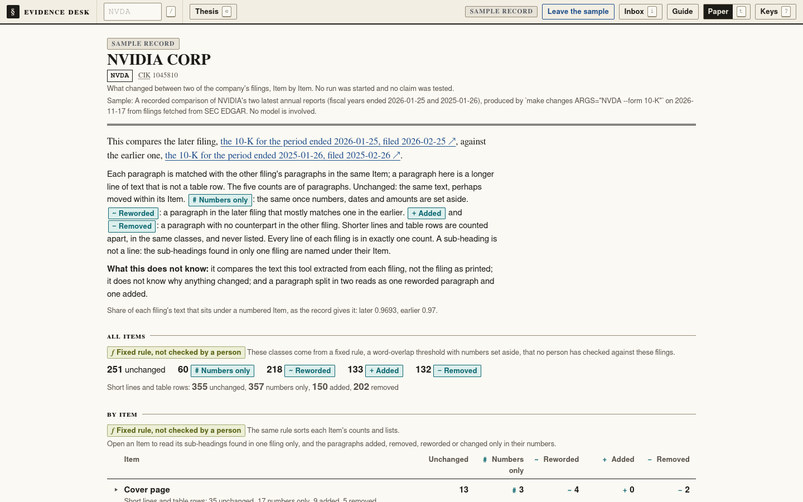
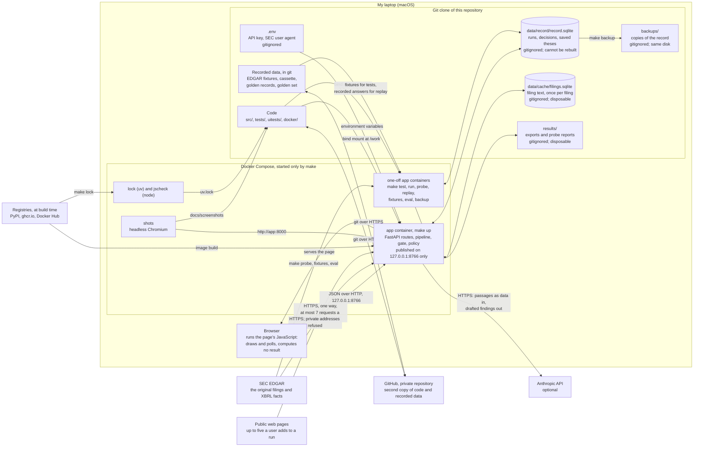

# Evidence Desk

Evidence Desk tests the claims of an investment thesis against a company's own SEC filings. It is for an equity analyst who has to decide whether a thesis still holds after a new filing: you enter a ticker, the decision and the claims; it reads the latest annual report (10-K) and the quarterly reports (10-Q) filed after it, computes the company's reported figures from its XBRL facts, and returns a verdict for each claim with the exact passages and figures behind it.

Two things are checked mechanically by the backend before anything reaches the page or the Markdown export: every quote is found word for word in a passage that was shown to the engine, and every number in a finding or in its reason is matched to one of its quotes or to a reported figure it cites. A third check is a model's: a second model, which is not shown the first one's reasoning, reads each finding's evidence and says whether it supports the statement. That is still a model's reading, of the same family as the first, so you accept or reject each finding yourself, and a second verdict follows, by the same rule, from the findings you accepted. A thesis can be saved and run again when a new filing arrives; the page then shows which verdicts moved.

Separately from any thesis, it shows what a company added, removed and reworded between its two latest annual or quarterly reports.

"Word for word" means a span of the text this tool extracted from the filing. Table rows are flattened in that text, and a quote is located under the Item and sub-heading the parser found.

This is version 6 (tag `capstone-v6`) of the capstone. The plan and the milestones are in [`../README.md`](../README.md), the design is in [`ARCHITECTURE.md`](ARCHITECTURE.md), and the tests are described in [`docs/testing.md`](docs/testing.md).


## Run it

You need Docker running and Make. From this directory, or from the repository root:

```sh
cp .env.example .env   # optional: ANTHROPIC_API_KEY, ANTHROPIC_MODEL, SEC_USER_AGENT
make up                # http://127.0.0.1:8766
make down
```

- **Without any key** the app works on real filings: the deterministic engine quotes the sentences that best match each claim and judges no stance, so claims read "passages found, not judged". **Reported figures only** needs just a ticker.
- **With `ANTHROPIC_API_KEY`** Claude plans the retrieval queries, drafts findings with a stance and writes the summary. The same checks apply to everything it returns.
- **Without the network or a key** you can still see a judged run: open <http://127.0.0.1:8766/?sample>, or run `make replay`. <http://127.0.0.1:8766/?sample=changes> shows a recorded comparison of NVIDIA's two latest annual reports. Both use three recorded NVIDIA filings and model answers replayed from a cassette ([`docs/cassettes.md`](docs/cassettes.md)).
- **With the network and no key**, `make up-recorded` starts the app with those recorded answers: **Load example**, then **Test the thesis**, gives the judged run on filings fetched live, and you can review it and save it. This works while NVIDIA's reported facts are as they were on 17 November 2026; after its next filing the prompts will no longer match the recording, and the run will fall back to the keyless engine and say so.

## What you see

1. Click **Load example** (five claims about NVIDIA) and **Test the thesis**.
2. The banner gives the status and what was read, each number with its denominator.
3. The verdicts come first, one row per claim, each naming the engine that assessed it. A legend on the page says what every mark means.
4. The reported figures follow: the newest quarter and the newest fiscal year, each figure opening to its arithmetic and the reported facts it used, with charts over time.
5. Open a claim to read its findings. Each excerpt is shown in its surrounding text with the Item of the filing it sits under and a link that opens the filing at that passage. Each finding lists its checks: the quote was found, the numbers matched, and whether its meaning was checked.
6. **Accept** or **Reject** each finding, with a note if you like. The scorecard shows two verdicts per claim: the engine's, and the one that follows from the findings you accepted. Undecided findings do not count toward yours.
7. **Save this thesis**, and later **Run again on the latest filings**. **What moved** compares the two newest runs: which verdicts changed, which excerpts are new, which filing is new.
8. **Download Markdown brief** exports the verified record; once every finding is decided, **Download reviewed brief** includes your decisions.
9. **What changed in the filings** needs only a ticker. It compares the latest annual report with the one before it (or the latest quarterly report with the previous one), Item by Item: how many paragraphs are unchanged, changed only in their numbers, reworded, added and removed, and then the paragraphs themselves, each linked into its filing, the reworded ones with the changed words marked.



From the command line, `make run ARGS='example'` runs the same pipeline and writes `results/<run-id>.json` and `.md`; `make changes ARGS="NVDA --form 10-K"` writes the filing comparison. `make probe TICKERS="AAPL COST"` reports how well a company's filings split into their Items.

## The system



**Where each part runs.** Everything runs on one laptop. The served backend is one container. The page's JavaScript runs in the browser, not in the container that serves it. `make test`, `run`, `probe`, `replay`, `fixtures`, `eval` and `backup` each start a separate short-lived container from the same image; these bypass the served app, and the ones that read filings reach EDGAR themselves. Nothing listens beyond `127.0.0.1`.

**How code reaches it.** The repository is mounted into every container, so the running code is the working tree. Dependencies are installed when the image is built, from PyPI and the container registries, never while it runs. The only other copy of the code is the private GitHub repository, reached by `git push` over HTTPS.

**How data reaches it.** Filings and XBRL facts come one way from SEC EDGAR over HTTPS; nothing is written to EDGAR. A user may add up to five public pages to a run, fetched with private addresses refused. With a key, passages go to the Anthropic API as data and drafted findings come back.

**What cannot be rebuilt.** The storage is split along that line: a record that is backed up, and a cache that can be deleted.

| Data | Can it be rebuilt? | Copies |
| --- | --- | --- |
| Run records, decisions on findings, saved theses: `data/record/record.sqlite` | **No.** A run's inputs move: the facts feed changes with every filing and restatement, the list of "latest" filings moves, the parser changes, and a model does not repeat itself. A decision is a person's and exists nowhere else | The laptop, and `backups/` on the same disk (`make backup`, checked by `make restore-check`). **No copy off the laptop** |
| Filing text: `data/cache/` | Yes, from EDGAR, by the parser version that produced it | The laptop; disposable |
| The facts feed and the list of filings, as they were | No: EDGAR serves their current state | EDGAR |
| Recorded fixtures and golden records | Only as a new baseline: recording again gives different facts and moves the tripwire | Laptop and GitHub |
| The cassette of model answers | No | Laptop and GitHub |
| `results/` | Disposable. One copy; what is worth keeping is copied into `demo/` or `docs/` and committed | The laptop |
| Keys in `.env` | Yes, reissued by the provider | The laptop |

## Measured results (17 November 2026)

Every number below was produced by the command named. Where the output is not otherwise in the repository it is committed under [`docs/evidence/`](docs/evidence/).

**A recorded, model-backed run** (`make replay`; the record is [`demo/recorded-run-v5.md`](demo/recorded-run-v5.md)). The example thesis on NVIDIA's 10-Q for the period ended 2026-07-26, its 10-Q for 2026-04-26 and its 10-K for 2026-01-25:

| | |
| --- | --- |
| Status | **COMPLETE** |
| Sources read | 3 of 3 filings, plus the XBRL company facts; 636 passages indexed |
| Verdicts | 2 supported, 3 mixed evidence, of 5 claims |
| Findings | 18 of 18 proposed findings verified, 0 withheld. 17 rest on a quote; **1 rests on reported figures only** |
| Quotes | 18 of 18 found word for word in a passage shown to the engine |
| Numbers in findings and their reasons | 25 checked against quotes and cited figures, 0 unmatched |
| Meaning check | 18 findings read by a second model: 17 agreed, 1 agreed only in part, 0 withheld |
| Reported figures | 156 computed (2 more reported as unavailable, with the reason) |

The model answers in that run did **not** come through the Anthropic API, which refused every call from this project for lack of credit. The engine's exact prompts were answered by Claude Sonnet 5.5, and the meaning check's by Claude Haiku 5.5, each running as a Claude Code subagent, and recorded ([how, and what that limits](demo/cassettes/nvda-example/README.md)). The first recording verified 15 of 18 findings: three quotes read "Compute &amp;amp; Networking", as the prompt had escaped them. That was a bug in the engine, now fixed with a test.

The one finding that rests on figures alone is the case a hostile review singled out ([`docs/referee-triage.md`](docs/referee-triage.md)): it sets company-wide revenue against a claim about China. Such a finding now counts toward a verdict only if the second model agrees that the figure bears on the claim. Here the second model did agree, so the verdict is unchanged. Two models of one family agreed with each other; that is a reason to reject the finding yourself if you disagree, not evidence that it is right.

**Retrieval and generation on a golden set, scored apart** (`make eval`; [`eval/README.md`](eval/README.md), [`docs/retrieval.md`](docs/retrieval.md)). Thirty cases over five companies, each an analyst's claim in its own words with the excerpt a correct answer must cite; six are unanswerable on purpose.

| Retrieval: the passage that must come back, of 24 answerable cases | Top 3 | Top 8 (what the engine is shown) | Top 20 |
| --- | --- | --- | --- |
| The claim's own words | 5 | 9 | 13 |
| With the planner's queries (the pipeline when a model is configured) | 12 | 18 | 21 |
| Three other rankings, defined before any was measured | 10 to 13 | 16 to 18 | 20 to 22 |

None of the three other rankings beat the planner's queries without losing a case it had, so none is wired in.

| Generation, with the planner's queries | |
| --- | --- |
| Verdict agrees with the expected stance | 20 of 24 answerable cases; no case where "supports" came back "challenged" or the reverse |
| ... where the passage that must come back was among the eight shown | 15 of 18 |
| Unanswerable claims refused | 6 of 6 |
| Quotes found word for word | 84 of 84 |
| Numbers matched | 67 of 70; the 3 unmatched withheld 2 findings |
| Meaning check | 77 findings read: 66 agreed, 10 agreed only in part, 1 withheld. It changed no verdict: 20 of 24 before and after |

Read these with three cautions. The cases and their expected stances were drafted by a model from the filing text and validated mechanically; **no person has read them one by one yet**, so "agrees" means agrees with that model's reading. The model answers are recorded from a stand-in (with a minimal wrapper around the prompts, no reminder of the rules). And 24 cases is a small set: an earlier run of the same evaluation, before the per-filing cap was fixed and ten answers were recorded again, gave 17 of 24, so a difference of three cases is within what re-recording alone can move.

**Reported figures against an answer key.** Twenty-eight published values, entered by hand with the statement each comes from: fiscal-year revenue, net income, diluted earnings per share and gross margin for Apple (fiscal 2022 to 2024), Microsoft (2023, 2024) and NVIDIA (2024, 2025). All match the recorded XBRL data. Nothing else is keyed: the other margins, cash flow and every quarterly figure rest on identities and on agreement between reported and differenced values, which is self-consistency, not truth. Free cash flow here is operating cash flow less purchases of property and equipment, which may differ from a company's own definition.

**Filing structure on eight companies** (`make probe`, 14 filings; [`docs/speed/probe-v4.md`](docs/speed/probe-v4.md)): NVIDIA, Apple, Microsoft, Coca-Cola, Tesla, Costco and Amazon have 95.8% to 98.6% of their text under a numbered Item. That is a share of text, not a count of Items found against Items present, and it cannot show a wrong boundary. JPMorgan's 10-Q has 1.6%: it prints no Item headings over its body, and a run on it is now marked partial. Its 10-K scores 99.4%, which overstates it, because its annual report follows Item 15.

**What changed between two filings** (`make changes`; [`docs/filing-changes.md`](docs/filing-changes.md)), measured on NVIDIA on 17 November from filings fetched live:

| Paragraphs | Unchanged | Numbers only | Reworded | Added | Removed |
| --- | ---: | ---: | ---: | ---: | ---: |
| Annual report for fiscal 2026 against fiscal 2025 | 606 | 417 | 218 | 133 | 132 |
| of which Item 1A, Risk Factors | 139 | 1 | 51 | 34 | 22 |
| Quarterly report for the second quarter of fiscal 2027 against the first | 314 | 182 | 108 | 71 | 66 |

Among the risk factors added in the annual report is one about an investment and partnership agreement with OpenAI that was not yet final; among those removed, a group of paragraphs about an export rule that has since been rescinded. The method's one threshold (how similar two paragraphs must be to count as reworded) was set by reading the pairs each candidate value would add, on these two comparisons only. The comparison has since been run on the annual reports of the other seven probe companies ([`docs/evidence/changes-eight-companies.md`](docs/evidence/changes-eight-companies.md)): it ran on all eight and matched every Item of one report to its Item in the other, but nobody has read those seven results, and no person has checked the classification on any. Running it on JPMorgan found two things: its earlier annual report was not in EDGAR's recent index at all (fixed: older index pages are now read, up to twelve), and 6,460 of its 7,253 paragraphs sit under "Item 15", because the bank's annual report follows its last Item heading. The exit check of the plan is a test: one planted paragraph comes back as exactly one added and one removed.

**The live application, end to end** (`make live-walk`; output in `docs/evidence/`): the running app over HTTP, filings fetched live, recorded answers. The walk fails unless the run is judged. It will fail after NVIDIA's next filing, when the recording no longer matches.

**Backup and restore** (`make backup`, `make restore-check`; output in `docs/evidence/`): a restore of the newest backup is compared with the live record, every run, decision and thesis. Same disk, same machine.

**Speed** ([`docs/speed.md`](docs/speed.md)). The offline profile is not where a real run's time goes: a real run waits on EDGAR and, with a key, on the model, which has never been timed. What was measured: a first live keyless run took 1.01 s and a second, with all three filings read from the cache, 0.38 s (one pair of runs). Offline, cutting the inline-XBRL header before parsing saves a median of 28.8 ms per run over 20 alternating pairs, about 7 to 9% of the offline run and well under 1% of a live one. Concurrent assessment of claims is a tested mechanism; its gain with a real model is unmeasured.

## Verification

```sh
make verify         # build, lint, 1,094 offline tests, smoke test, browser-level test
make test           # offline tests only (T=tests/test_gate.py for one file)
make golden-check   # the tripwire: one recorded run, compared stage by stage
make replay         # the recorded model-backed run, offline
make uitest         # headless Chromium renders three records; 69 assertions on the DOM
make live-walk      # the running app end to end over HTTP: needs EDGAR, no key
make eval ARGS="run --variant claim"   # score retrieval on the golden set
make backup         # copy the record to backups/; make restore-check proves it restores
make changes ARGS="NVDA --form 10-K"    # what changed between a company's two latest annual reports
make screenshots    # renders the page into docs/screenshots, for a person to look at
```

[`docs/testing.md`](docs/testing.md) names one test at each of four levels, the wrong programs each new test now fails on, the tripwire and how to read it, and what no test here can see.

## Known limitations

- **The link that opens a filing at a passage has not been checked in a browser.** It is built with a text fragment from the excerpt's first and last words. An excerpt that spans lines links by its first line; a table row links to the filing without a passage, and the page says which. A headless browser sent to sec.gov to check one link was refused as an undeclared automated tool. Click one before relying on them.
- **The Anthropic API path has not been exercised live since version 1** (22 October). The engine and the checker are tested against stub clients and through recorded answers; neither exercises the SDK call.
- **The meaning check is a second model of the same family.** It reads without the first model's reasoning, but it is not an independent party. On the golden set it withheld 1 of 77 findings and changed no verdict.
- **Retrieval decides what the engine can see.** With the planner's queries the passage that matters is among the eight shown in 18 of 24 golden cases. In the other six a claim is judged on weaker evidence, and no later check can see what retrieval left out.
- **The golden set is a model's reading until a person has read it.**
- **Tables are flattened.** A table row is one line of numbers with its column headers lost, so the number check can match a figure from the wrong period, and a link cannot locate it.
- **The number check has blind spots.** It ignores numbers written as words and bare integers up to 12. A cited figure only has to contain a matching number of the right unit; whether it is the right figure is left to the meaning check and to you.
- **Pages a user adds are fetched with the address checked at lookup, not pinned at connection.** A hostile DNS server could change its answer in between. This is a local, single-user tool; pinning is later work.
- **The record has no copy off this laptop.** `make backup` writes to the same disk.
- **Filings without Item headings over their body** (JPMorgan's 10-Q) are kept and quotable, located by sub-heading only, and a run on one is partial.
- **The page was checked by eye from screenshots** and by a DOM test, not by a user. Dark mode was not checked.
- **The filing comparison is tuned on one company.** Its threshold was set on NVIDIA's reports; on seven other companies it has run but its results are unread. A paragraph rewritten into several reads as one removed and several added. Tables are not compared. Where a filing's body does not sit under its Item headings (JPMorgan), the Item named beside a change is not meaningful.
- Only 10-K and 10-Q filers. No PDFs, 8-K exhibits, foreign filers or transcripts. Runs execute in a worker thread inside the API process; there is no queue and no resume after a restart.
