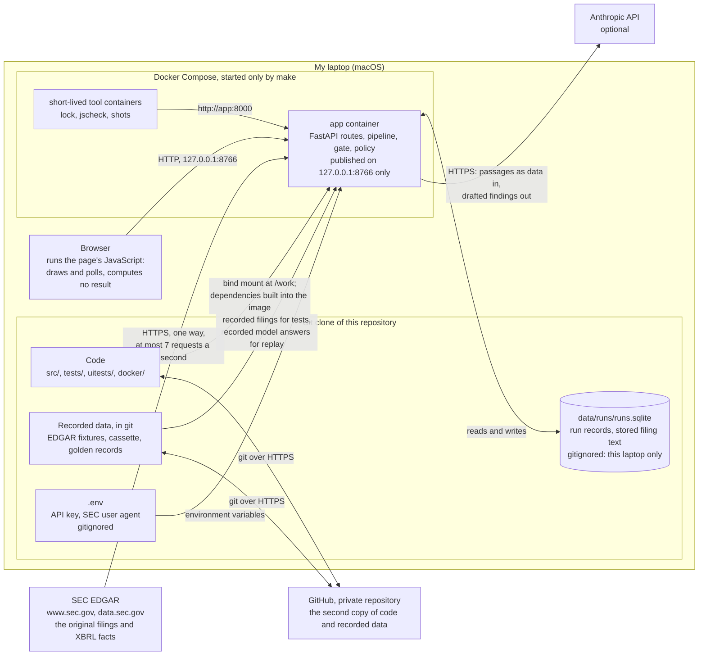

# Evidence Desk

Evidence Desk tests the claims of an investment thesis against a company's own SEC filings. It is for an equity analyst who has to decide whether a thesis still holds after a new filing: you enter a ticker, the decision and the claims; it reads the latest annual report (10-K) and the quarterly reports (10-Q) filed after it, computes the company's reported figures from its XBRL facts, and returns a verdict for each claim with the exact passages and figures behind it.

Two things are checked by the backend before anything reaches the page or the Markdown export: every quote is found word for word in the stored filing text, and every number in a finding is matched to one of its quotes or to a reported figure it cites. One thing is not checked: whether a quote means what the finding says. That is the engine's reading, and the page says so beside every verdict.

This is version 3 (tag `capstone-v3`) of the capstone. The plan and the milestones are in [`../README.md`](../README.md), the design is in [`ARCHITECTURE.md`](ARCHITECTURE.md), and the tests are described in [`docs/testing.md`](docs/testing.md).


## Run it

You need Docker running and Make. From this directory, or from the repository root:

```sh
cp .env.example .env   # optional: ANTHROPIC_API_KEY, ANTHROPIC_MODEL, SEC_USER_AGENT
make up                # http://127.0.0.1:8766
make down
```

- **Without any key** the app works on real filings: the deterministic engine quotes the sentences that best match each claim and judges no stance, so claims read "passages found, not judged". **Reported figures only** needs just a ticker.
- **With `ANTHROPIC_API_KEY`** Claude plans the retrieval queries, drafts findings with a stance and writes the summary. The same checks apply to everything it returns.
- **Without the network or a key** you can still see a judged run: open <http://127.0.0.1:8766/?sample>, or run `make replay`. Both use three recorded NVIDIA filings and model answers replayed from a cassette ([`docs/cassettes.md`](docs/cassettes.md)).

## What you see

1. Click **Load example** (five claims about NVIDIA) and **Test the thesis**.
2. The banner gives the status and what was read, each number with its denominator.
3. The verdicts come first, one row per claim, each naming the engine that assessed it. A legend on the page says what every mark means.
4. The reported figures follow: the newest quarter and the newest fiscal year, each figure opening to its arithmetic and the reported facts it used, with charts over time.
5. Open a claim to read its findings. Each excerpt is shown in its surrounding text with the Item of the filing it sits under and a link that opens the filing at that passage. Each finding lists its checks: the quote was found, the numbers matched, and whether its meaning was checked.
6. **Download Markdown brief** exports the same verified record.

From the command line, `make run ARGS='example'` runs the same pipeline and writes `results/<run-id>.json` and `.md`. `make probe TICKERS="AAPL COST"` reports how well a company's filings split into their Items.

## The system



**Where each part runs.** Everything runs on one laptop. The backend is one container; the page's JavaScript runs in the browser, not in the container that serves it. Nothing listens beyond `127.0.0.1`.

**How code reaches it.** The repository is mounted into the container, so the running code is the working tree; dependencies are installed when the image is built, never while it runs. The only other copy of the code is the private GitHub repository, reached by `git push` over HTTPS.

**How data reaches it.** Filings and XBRL facts come one way from SEC EDGAR over HTTPS and are stored per run in SQLite. With a key, passages go to the Anthropic API as data and drafted findings come back. Nothing is ever written to EDGAR.

**What cannot be rebuilt.**

| Data | Can it be rebuilt? | Copies |
| --- | --- | --- |
| Filings and XBRL facts | Yes: EDGAR keeps them, and a filing never changes | EDGAR; a per-run copy in SQLite |
| Recorded fixtures, the cassette, the golden records | The fixtures yes. The cassette no: a model will not give the same answers twice | Laptop and GitHub |
| Run records in `data/runs/runs.sqlite` | No: a run with model answers cannot be reproduced | **This laptop only. No backup** |
| Decisions on findings | None are stored yet; accepting or rejecting a finding is milestone 4 | — |
| Keys in `.env` | Yes, from the provider's console | Laptop only |

## Measured results (17 November 2026)

**A recorded, model-backed run** (`make replay`; the record is [`demo/recorded-run-v3.md`](demo/recorded-run-v3.md)). The example thesis on NVIDIA's 10-Q for the period ended 2026-07-26, its 10-Q for 2026-04-26 and its 10-K for 2026-01-25:

| | |
| --- | --- |
| Status | **COMPLETE** |
| Sources read | 3 of 3 filings, plus the XBRL company facts; 636 passages indexed |
| Verdicts | 2 supported, 3 mixed evidence, of 5 claims |
| Findings | 18 of 18 proposed findings verified, 0 withheld |
| Quotes | 18 of 18 found word for word in the stored filings |
| Numbers in findings | 25 checked against quotes and cited figures, 0 unmatched |
| Reported figures | 156 computed (2 more reported as unavailable, with the reason) |

The model answers in that run did **not** come through the Anthropic API. The API refused every call from this project for lack of credit, so the engine's exact prompts were answered by Claude Sonnet 5.5 running as a Claude Code subagent and recorded ([how, and what that limits](demo/cassettes/nvda-example/README.md)). The instructions around those prompts repeated the engine's rule about exact quotes, so 18 of 18 is an upper bound on what the API path would give. The first recording verified 15 of 18: three quotes read "Compute &amp;amp; Networking", as the prompt had escaped them, and the gate could not find them. That was a bug in the engine, now fixed with a test.

**Reported figures against an answer key.** Fiscal-year revenue and net income computed from XBRL facts equal the values published in the companies' annual reports for Apple (fiscal 2022 to 2024), Microsoft (2023, 2024) and NVIDIA (2024, 2025), fourteen figures in all, and the revenue growth rates derived from them. Wherever a company reported both a quarter and the year-to-date totals around it, the differenced value equals the reported one, except one NVIDIA quarter that differs by USD 1 million because each figure was rounded on its own.

**Filing structure on eight companies** (`make probe`, 14 filings): NVIDIA, Apple, Microsoft, Coca-Cola, Tesla, Costco and Amazon split into their Items with 95.8% to 98.6% of their text under a numbered Item. JPMorgan's 10-Q does not (1.6%): it prints no Item headings over its body. Its 10-K scores 99.4%, which overstates it, because its annual report follows Item 15 and is all labelled under that Item. The probe found three parser faults that NVIDIA's filings had hidden; all three are fixed and Costco's 10-K is now a second full-size fixture.

**Speed.** The offline example run takes 0.41 s (median of five runs), and parsing three filings is 66% of it. Cutting the inline-XBRL header before parsing saved 8%, with the tripwire's hash unchanged. Claims are now assessed three at a time: with a stand-in engine that waits 200 ms per call, five claims take 0.50 s against 1.13 s one at a time. The real model's latency could not be measured in this version. Details in [`docs/speed.md`](docs/speed.md).

**The live keyless path** was measured in version 2: three filings fetched from EDGAR and parsed, 636 passages indexed, 15 of 15 quotes verified, 3.2 s ([`demo/demo-2026-11-17-v2.md`](demo/demo-2026-11-17-v2.md)).

## Verification

```sh
make verify         # build, lint, 708 offline tests, smoke test, browser-level test
make test           # offline tests only (T=tests/test_gate.py for one file)
make golden-check   # the tripwire: one recorded run, compared stage by stage
make replay         # the recorded model-backed run, offline
make uitest         # headless Chromium renders two records; 25 assertions on the DOM
make screenshots    # renders the page into docs/screenshots, for a person to look at
```

[`docs/testing.md`](docs/testing.md) names one test at each of four levels, the wrong programs each new test now fails on, the tripwire and how to read it, and what no test here can see.

## Known limitations

- **The Anthropic API path has not been exercised live since version 1** (22 October). The engine is tested against a stub client and through recorded answers; neither exercises the SDK call.
- **Whether a quote supports the statement made about it is not checked.** The quote check and the number check are mechanical. A second-model check of meaning is milestone 5; until then a "Supported" verdict rests on a model's reading of real sentences.
- **Retrieval is unmeasured.** Passages are ranked by BM25. The golden set that measures how often the right passage is in the top eight is milestone 5.
- **The number check has blind spots.** It ignores numbers written as words, bare integers up to 12, and years; it accepts a table number at any of four scales. It catches a figure that is nowhere in the evidence, not one that is attached to the wrong thing.
- **Filings without Item headings over their body** (JPMorgan's 10-Q) are kept and quotable but located by sub-heading only; the run says so.
- **The page was checked by eye from four screenshots** and by a DOM test, not by a user. Dark mode and the links that open a filing at a passage were not checked in a real browser.
- Only 10-K and 10-Q filers. No PDFs, 8-K exhibits, foreign filers or transcripts. Runs execute in a worker thread inside the API process; there is no queue and no resume after a restart.
