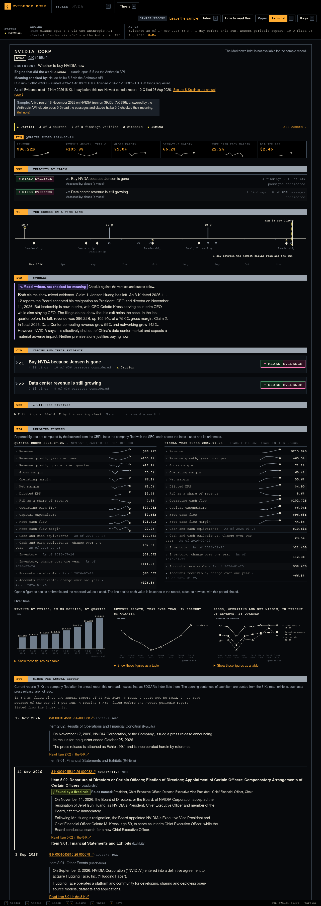
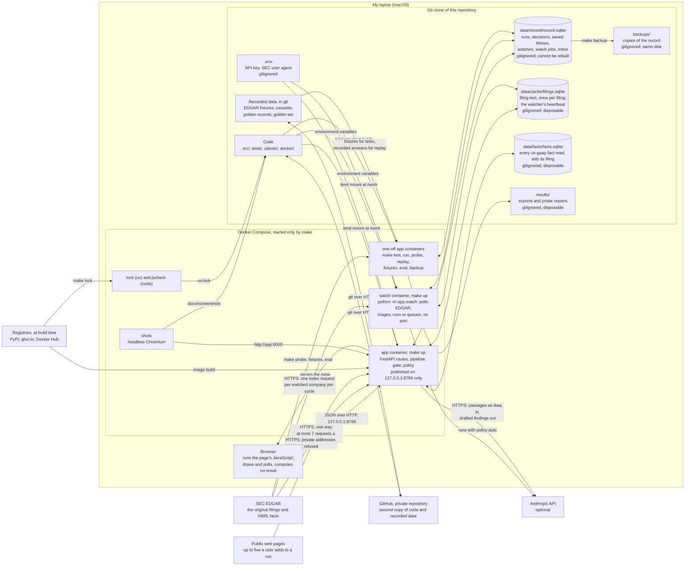

# Evidence Desk

Evidence Desk tests the claims of an investment thesis against a company's own SEC filings. It is for an equity analyst who has to decide whether a thesis still holds after a new filing: you enter a ticker, the decision and the claims; it reads the latest annual report (10-K) and the quarterly reports (10-Q) filed after it, lists the current reports (8-K) filed since the annual report and reads the ones that matter, computes the company's reported figures from its XBRL facts, and returns a verdict for each claim with the exact passages and figures behind it.

Two things are checked mechanically by the backend before anything reaches the page or the Markdown export: every quote is found word for word in a passage that was shown to the engine, and every number in a finding or in its reason is matched to one of its quotes or to a reported figure it cites. A third mechanical check reports, and withholds nothing: a year or fiscal label a finding names that its own evidence does not carry. A fourth check is a model's: a second model, which is not shown the first one's reasoning, reads each finding's evidence and says whether it supports the statement. That is still a model's reading, of the same family as the first, so you accept or reject each finding yourself, and a second verdict follows, by the same rule, from the findings you accepted. A thesis can be saved and run again when a new filing arrives; the page then shows which verdicts moved.

It also shows what a company added, removed and reworded between its two latest annual or quarterly reports, and, under each claim of a run, which of the paragraphs that changed since the filing before share words with that claim or with the search queries the run wrote for it: a reading list for the question the tool exists for, what is new since the last filing. And it reads from a filing's own tagged facts the figures a thesis is usually about and the SEC's company-facts data does not carry: revenue by segment, by product and by geography, and each large customer's share. A run can ask to be offered those figures, so that a finding can cite them.

"Word for word" means a span of the text this tool extracted from the filing, which is not the filing byte for byte: table rows are flattened into lines, zero-width characters are removed, non-breaking and repeated spaces become one space, and a "$" or "%" printed in a cell of its own is joined to its number. A quote is located under the Item and sub-heading the parser found, and it must be whole: one that begins or ends inside a word, or inside a number at a decimal point or a thousands separator, is not accepted, so "46.7" cannot be quoted out of "46.78 billion". In the Markdown brief, every character of an excerpt that Markdown would act on is escaped with a backslash, so a viewer shows the excerpt as text and an excerpt cannot become a link, an image or a heading. A bare web address inside an excerpt can still be made clickable by a viewer that links addresses on its own.

This is version 14 (0.14.0, not tagged) of the capstone. Version 14 gives every reported fact the date it was filed ([`docs/facts.md`](docs/facts.md)): a run can be as of a past date and then reads only what had been filed by then, every fact the app reads is kept in a fact store, and a company's restated values are listed with both filings. It also turns a claim such as "Gross margin is expanding" into a test computed from those facts, with the arithmetic and the outcome as of each filing of the last five years, and counts the outcome in the claim's verdict ([`docs/claim-tests.md`](docs/claim-tests.md)); a claim it cannot turn into a test says why and is judged as before. Version 13 (0.13.0, tag `capstone-v13`) added the standing watch: a saved thesis can be put on watch, a second process reads the company's filing index every 15 minutes, decides by rule which claims a new filing bears on, and either runs the thesis again or leaves the run waiting in an inbox on the page ([`docs/watch.md`](docs/watch.md)). Version 12 dates a run's evidence and reads what the company reported since its annual report: every 8-K filed after it is listed, the ones after the newest quarterly report and those on a substantive subject are read and split into their items, a claim on such a subject is offered the matching sections, and a finding that a later 8-K on its claim's subject postdates is marked so ([`docs/events.md`](docs/events.md)). It was built after a run answered "buy NVDA because Jensen is gone" from an annual report in which he is chief executive. Version 8 listed, under each claim of a run, what changed in the filings ([`docs/claim-changes.md`](docs/claim-changes.md)). Version 9 read revenue by segment, product and geography and customers' shares from each filing's own tagged facts ([`docs/breakdowns.md`](docs/breakdowns.md)). Version 10 lets a finding cite those figures ([`docs/tagged-figures.md`](docs/tagged-figures.md)), answers a third hostile reading ([`docs/referee-3-triage.md`](docs/referee-3-triage.md)), and fixes three faults in the reported figures that testing on few companies had hidden ([`docs/evidence/figures-eight-companies.md`](docs/evidence/figures-eight-companies.md)). Version 11 reports a year a finding names that is nowhere in its evidence, and measures what that check catches ([`docs/period-check.md`](docs/period-check.md)); it also answers a sixth blind review, of the system: a restore check that compares every record, the app and a one-off container writing one record at once, and a live run timed stage by stage. Version 11.1 answers a fourth hostile reading, finding by finding ([`docs/referee-4-triage.md`](docs/referee-4-triage.md)): a quote may no longer begin or end inside a word or a number, the restore check compares every column of the record, the Markdown brief escapes whatever Markdown would act on, and two published speed figures that had been measured wrongly are corrected. The plan and the milestones are in [`../README.md`](../README.md), the design is in [`ARCHITECTURE.md`](ARCHITECTURE.md), and the tests are described in [`docs/testing.md`](docs/testing.md).


The page is a research note in two themes over one layout: Paper, as printed, and Terminal, a dense dark screen (the switch in the bar, the `t` key, or your system's setting). `/` focuses the ticker, `e` opens your thesis beside a result, `j` and `k` move between claims, `?` lists the keys, and printing gives a clean copy of the note. `?sample=run-events` shows a live NVIDIA run of 18 November 2026, answered by the Anthropic API, whose first claim an 8-K postdates. The design and every component are described in [`docs/design.md`](docs/design.md); `/specimen.html` shows each one on made-up data.



## Run it

You need Docker running and Make. From this directory, or from the repository root:

```sh
cp .env.example .env   # optional: ANTHROPIC_API_KEY, ANTHROPIC_MODEL, SEC_USER_AGENT
make up                # http://127.0.0.1:8766, and the watcher beside it
make down
```

- **Without any key** the app works on real filings: the deterministic engine quotes the sentences that best match each claim and judges no stance, so claims read "passages found, not judged". **Reported figures only** needs just a ticker.
- **With `ANTHROPIC_API_KEY`** Claude plans the retrieval queries, drafts findings with a stance and writes the summary. The same checks apply to everything it returns. This path has not run through the API since version 1 (22 October): both keys tried on 17 November were refused for lack of credit, so every model-backed result below comes from recorded answers.
- **Without the network or a key** you can still see a judged run: open <http://127.0.0.1:8766/?sample>, or run `make replay`. <http://127.0.0.1:8766/?sample=changes> shows a recorded comparison of NVIDIA's two latest annual reports, and <http://127.0.0.1:8766/?sample=breakdowns> the tagged breakdowns of the latest one. <http://127.0.0.1:8766/?sample=run-tagged> is the same thesis recorded again with the tagged figures offered to the engine. Both use three recorded NVIDIA filings and model answers replayed from a cassette ([`docs/cassettes.md`](docs/cassettes.md)).
- **With the network and no key**, `make up-recorded` starts the app with those recorded answers: **Load example**, then **Test the thesis**, gives the judged run on filings fetched live, and you can review it and save it. This works while NVIDIA's reported facts are as they were on 17 November 2026; after its next filing the prompts will no longer match the recording, and the run will fall back to the keyless engine and say so.

## What you see

1. Click **Load example** (five claims about NVIDIA) and **Test the thesis**.
2. The banner gives the status and what was read, each number with its denominator.
3. The verdicts come first, one row per claim, each naming the engine that assessed it. A legend on the page says what every mark means.
4. The reported figures follow: the newest quarter and the newest fiscal year, each figure opening to its arithmetic and the reported facts it used, with charts over time.
5. Open a claim to read its findings. Each excerpt is shown in its surrounding text with the Item of the filing it sits under and a link that opens the filing at that passage. Each finding lists its checks: the quote was found, the numbers matched, the years it names are in its evidence, and whether its meaning was checked.
6. **Accept** or **Reject** each finding, with a note if you like. The scorecard shows two verdicts per claim: the engine's, and the one that follows from the findings you accepted. Undecided findings do not count toward yours.
7. **Save this thesis**, and later **Run again on the latest filings**. **What moved** compares the two newest runs: which verdicts changed, which excerpts are new, which filing is new.
8. **Download Markdown brief** exports the verified record, followed by the reading list of item 9, set apart; once every finding is decided, **Download reviewed brief** includes your decisions.
9. **Changed since the previous annual and quarterly report**, under each claim, lists the paragraphs that were added, removed, reworded or changed in their figures between the newest annual report and the newest quarterly report the run read and the filing of the same form before each, when they share at least two words with the claim or with the search queries the run wrote for it: the five best by keyword overlap, each linked into its filing. An older quarterly report the run read is not compared, and the earlier filing of a pair may be one the run did not read. It is a reading list. No model chose or judged these, none counts toward the verdict, and the block is marked as a keyword match that nobody has checked.
10. **What changed in the filings** needs only a ticker. It compares the latest annual report with the one before it (or the latest quarterly report with the previous one), Item by Item: how many paragraphs are unchanged, changed only in their numbers, reworded, added and removed, with short lines and table rows counted apart. Under each Item it names the sub-headings found in only one filing and lists the paragraphs, each linked into its own filing: the added and the removed ones, the reworded ones with the changed words marked, and those whose figures alone moved with the figures marked.
11. **Segments and customers (tagged facts)** needs only a ticker too. It reads the latest annual or quarterly report's own tagged numbers into tables: revenue by business segment, by product or service and by geography, and customers' shares of revenue, each with its change from the year before and a line saying whether the members add up to the filing's tagged total. The labels are made from tag names and are not the company's own. The view reads the latest filing when asked and is tied to no run.
12. **As of** under the run's details says how old the evidence is: the newest filing read, its date and how many days before the run, and the newest periodic report. **Since the annual report** lists every 8-K the company filed after the annual report the run read, newest first: its items with their SEC titles and categories, and for the 8-Ks read the opening sentences of each item, linked to the filing, and the roles an Item 5.02 names. A line counts how many were read, could not be read, were left by the cap, and were routine and listed from the index only. A claim on a subject an 8-K can report (a change of officers, an accounting problem, a deal, and so on) gets a caution when its verdict rests on a finding filed before such an 8-K, or a note saying that none was filed since the annual report up to the newest filing read. Neither changes a verdict. `make events T=NVDA` prints the same list for any company.
13. **Computed tests**, in the Markdown brief and on each claim of the run record (`Claim.computed`): a claim that compiles to a test shows the test, the periods it was computed for, the arithmetic from the reported facts with each filing, whether it holds, and a table of the outcome as of each 10-K and 10-Q filing date of the last five years, with the flips marked. A test that holds counts as support in the verdict, one that fails as a challenge, one that cannot be computed as nothing, with the reason. A claim that does not compile says why. No model is involved. The page does not draw these yet; the payloads are in [`docs/examples/v14/`](docs/examples/v14/README.md).
14. **As of a past date**: `make run ARGS='run --ticker NVDA --decision "..." --claim "..." --as-of 2026-03-01'` (or `as_of` in `POST /api/runs`) reads the newest 10-K filed by then, the 10-Qs and 8-Ks after it up to the date, and only the facts filed by the date. `make restatements T=NVDA` (or `GET /api/companies/NVDA/restatements`) lists every period whose value changed between filings.
15. **Also offer the figures tagged in the filings**, a checkbox under Advanced, asks a run to show the engine those segment, product, geography and customer figures for the newest annual and quarterly report it read, so that a finding can cite one. They appear in the figures panel as a group of their own, and a finding that rests on figures alone, with no excerpt, says so beside its stance. It is off by default because it changes what the model is shown.


**The standing watch** (version 13). A saved thesis can be put on watch (`PUT /api/theses/{id}/watch`). The watcher, a second container started by `make up`, reads the company's filing index on EDGAR every 15 minutes; for each new 10-K, 10-Q or 8-K it decides by rule, without a model, which claims it bears on, and either runs the thesis again and says what moved, or leaves the run waiting for you (policy `ask`, the default; `auto` runs at once, at most five times a day). The inbox (`GET /api/inbox`) says what arrived and why it matters or does not. `make watch-status` says whether the watcher is alive; `make watch-once` does one cycle by hand. How it decides, what it costs and where it is wrong: [`docs/watch.md`](docs/watch.md); every payload: [`docs/examples/v13/`](docs/examples/v13/README.md). On the page, a saved thesis has its watch (put on, policy, taken off, with the last and next check and the last error), the bar has the inbox (`i`) with its unread count and the watcher's health, and the inbox gives each new filing its kind, the filing, the reasons per claim, what moved and, for a waiting run, a "Run now (uses the model)" button. <http://127.0.0.1:8766/?sample=inbox> shows the example payloads, copied unedited.


From the command line, `make run ARGS='example'` runs the same pipeline and writes `results/<run-id>.json` and `.md`; `make changes ARGS="NVDA --form 10-K"` writes the filing comparison. `make probe TICKERS="AAPL COST"` reports how well a company's filings split into their Items, and `make figures TICKERS="COST AMZN"` prints each company's quarters as a run would see them.

## The system



**Where each part runs.** Everything runs on one laptop. The served backend is one container; the watcher is a second one, from the same image, sharing the data directory and listening on no port. The page's JavaScript runs in the browser, not in the container that serves it. `make test`, `run`, `probe`, `replay`, `fixtures`, `eval` and `backup` each start a separate short-lived container from the same image; these bypass the served app, and the ones that read filings reach EDGAR themselves. Nothing listens beyond `127.0.0.1`.

**How code reaches it.** The repository is mounted into every container, so the running code is the working tree: the image holds only the dependencies, and a changed file is served without a rebuild (the page's files at once, Python code when the app is next started). `jscheck` mounts the tree read-only. The app, the one-off containers, `lock` and `shots` mount it read-write; `shots` is a third-party image (headless Chromium), and what it writes is the screenshots and the page dumps. Dependencies are installed when the image is built, from PyPI and the container registries, never while it runs. The only other copy of the code is the private GitHub repository, reached by `git push` over HTTPS.

**How data reaches it.** Filings and XBRL facts come one way from SEC EDGAR over HTTPS; nothing is written to EDGAR. A user may add up to five public pages to a run, fetched with private addresses refused. With a key, passages go to the Anthropic API as data and drafted findings come back.

**What cannot be rebuilt.** The storage is split along that line: a record that is backed up, and a cache that can be deleted.

| Data | Can it be rebuilt? | Copies |
| --- | --- | --- |
| Run records, decisions on findings, saved theses: `data/record/record.sqlite` | **No.** A run's inputs move: the facts feed changes with every filing and restatement, the list of "latest" filings moves, the parser changes, and a model does not repeat itself. A decision is a person's and exists nowhere else | The laptop, and `backups/` on the same disk (`make backup`, checked by `make restore-check`). **No copy off the laptop** |
| Filing text: `data/cache/` | Yes, from EDGAR, by the parser version that produced it | The laptop; disposable |
| Facts with their filings: `data/facts/` | Yes, from EDGAR (`make facts-load`) | The laptop; disposable |
| The facts feed and the list of filings, as they were | No: EDGAR serves their current state | EDGAR |
| Recorded fixtures and golden records | Only as a new baseline: recording again gives different facts and moves the tripwire | Laptop and GitHub |
| The cassette of model answers | No | Laptop and GitHub |
| `results/` | Disposable. One copy; what is worth keeping is copied into `demo/` or `docs/` and committed | The laptop |
| Keys in `.env` | Yes, reissued by the provider | The laptop |

## Measured results, in brief (17 November 2026)

Every number has the command that produced it and its denominator in [`docs/results.md`](docs/results.md); outputs that are not otherwise in the repository are under [`docs/evidence/`](docs/evidence/).

| What was measured | Result | Full account |
| --- | --- | --- |
| The example thesis, recorded three times: five claims about NVIDIA, three filings (`make replay`) | First recording: complete, 18 of 18 findings verified, 18 of 18 quotes found word for word, 25 numbers checked and none unmatched. The same prompts recorded again with no reminder of the rules: again 18 of 18, 22 numbers and none unmatched, and a different verdict on one claim of five. With the tagged figures offered: 18 of 19 findings verified, one withheld for a number it did not cite | [`docs/results.md`](docs/results.md), [`demo/cassettes/`](demo/cassettes/) |
| Retrieval on the 30-case golden set (`make eval`) | The passage that must come back is among the eight shown for 9 of 24 answerable cases with the claim's own words, 18 of 24 with the planner's queries | [`docs/retrieval.md`](docs/retrieval.md) |
| Verdicts on the golden set | Agree with the expected stance in 20 of 24; no reversal; 6 of 6 unanswerable claims refused; 84 of 84 quotes found | [`eval/README.md`](eval/README.md) |
| The meaning check | Rejected 1 of 78 real findings and changed no verdict. Rejected 150 of 152 planted mismatches and accepted none | [`eval/README.md`](eval/README.md) |
| Reported figures against an answer key | 28 published values for Apple, Microsoft and NVIDIA match | [`docs/results.md`](docs/results.md) |
| Reported figures on eight companies (`make figures`) | Three faults found and fixed on 17 November: Costco's 16-week quarter was never derived, Amazon's trailing twelve months were taken for fiscal years, JPMorgan had no revenue. After each fix only that company's lines moved | [`docs/evidence/figures-eight-companies.md`](docs/evidence/figures-eight-companies.md) |
| Filings split into their Items (`make probe`) | 13 of 14 filings of eight companies; JPMorgan's quarterly report not | [`docs/results.md`](docs/results.md) |
| What changed between two filings (`make changes`) | Runs on eight companies' annual reports. NVIDIA: 251 paragraphs unchanged, 60 changed in figures only, 218 reworded, 133 added, 132 removed | [`docs/filing-changes.md`](docs/filing-changes.md) |
| Changes that bear on each claim | 802 changed paragraphs behind the example; the five best by keyword overlap listed per claim. Nobody has judged the lists | [`docs/claim-changes.md`](docs/claim-changes.md) |
| Tagged breakdowns (`make breakdowns`) | On sixteen filings of eight companies every breakdown adds up to the filing's tagged total. NVIDIA's are checked against the filing's own text | [`docs/breakdowns.md`](docs/breakdowns.md) |
| Tagged figures offered to the engine (`make replay` on two recordings made the same day) | Five verified findings cite one, and citations of figures go from 8 to 20. Not shown: that the option changes a verdict. Asking the same prompts again moved a verdict too | [`docs/tagged-figures.md`](docs/tagged-figures.md) |
| 8-Ks split into their items (`make events-probe`, 18 November) | Every 8-K of the last 12 months of eight companies: 190 of 200 listed items found before two fixes (Coca-Cola's "Item 9.01(d).", JPMorgan's "Item 5.02(e)"), 200 of 200 after | [`docs/events.md`](docs/events.md), [`docs/evidence/`](docs/evidence/) |
| Which claims an 8-K bears on (`make event-categories`) | On 84 claims labelled before the rule existed (39 with no category): precision 0.90 and recall 0.92 on the first score; 0.94 and 1.00 after one tuning pass on the same claims, so fitted. Three false alarms remain | [`docs/events.md`](docs/events.md) |
| NVIDIA's 8-Ks, live (`make events T=NVDA`, 18 November) | 12 since the annual report of 25 February, 8 read. The 8-K of 12 November, Item 5.02, reports the resignation of Jen-Hsun Huang as President and Chief Executive Officer | [`docs/evidence/events-nvda.txt`](docs/evidence/events-nvda.txt) |
| Claims compiled to tests (`make claim-labels`, 18 November) | 150 of 150 development claims compile exactly to their labelled test or to "none", on the first scoring and the last; 60 of 60 held-out claims, both times it was scored. Labels and grammar have one author, a Claude session, so this says the grammar covers that author's phrasings and nothing about anyone else's | [`docs/claim-tests.md`](docs/claim-tests.md) |
| Claims another model wrote (`make claim-foreign`, 18 November) | Of 40 held-out numeric claims written by Claude Sonnet 5.5 without seeing the grammar: 8 compiled to the right test, 11 to a wrong one, 21 not compiled (7, 15 and 18 before the grammar was changed on the other half). None of 37 non-numeric claims compiled. Then all 120 became development material and a claim compiles only when its test explains every word: of 83 numeric claims, 23 right, 0 wrong, 60 refused (22, 11, 50 before). The judge was the grammar's author, and the rule was written with these claims open. On a fresh set B of 120, scored once: of 80 numeric claims, 5 right, 1 wrong, 74 refused; none of 40 non-numeric claims compiled | [`docs/claim-tests.md`](docs/claim-tests.md) |
| Computed tests against an independent route (`tests/test_claim_results.py`) | 52 of 52 golden cases over NVIDIA, Apple and Microsoft agree on outcome, periods and both sides with expected values computed from the raw facts by code that never calls the evaluator | [`docs/claim-tests.md`](docs/claim-tests.md) |
| Verdicts moved by computed tests | The tripwire (extractive engine): one of five claims moves, "Gross margin is expanding" from unjudged to supported. The recorded replay: none of five moves | [`docs/claim-tests.md`](docs/claim-tests.md) |
| No lookahead (`tests/lookahead.py`) | As of every periodic filing date of NVIDIA, Apple and Microsoft and the day before (138, 140 and 136 dates), the metrics reference no fact filed later and equal those of a payload with the later facts deleted; the same for the ledger, computed claims and their histories, and a run | [`docs/facts.md`](docs/facts.md) |
| NVIDIA's restatements, live (`make restatements T=NVDA`, 18 November) | 28 of 922 periods reported by at least two filings changed value later; 17 are diluted EPS across stock splits; in 5 a later value goes back to an earlier one. Nobody has read them against the filings | [`docs/facts.md`](docs/facts.md) |
| A run as of 1 March 2026, live (NVIDIA, "Gross margin is expanding", no key) | Read the 10-K of 25 February 2026 alone; 75.0% against 73.0% a year earlier, holds; the outcome flipped 5 times over the 20 filings of the five years before; no fact filed after the date in the record | [`docs/facts.md`](docs/facts.md) |
| The standing watch's triage on a year of NVIDIA's real filings (`make watch-replay`, 18 November, live EDGAR, no model) | 19 filings fed one at a time; triage agreed with labels written before the replay on 12 of 19, and flagged 11 of the 13 labelled as bearing. Five false alarms, all Item 5.02 (a director or another officer, not the chief executive); two misses, both Item 8.01 (a $25 billion note issue, the Hugging Face acquisition). The labels are the building agent's, not a person's | [`docs/watch.md`](docs/watch.md), [`docs/evidence/watch-replay-nvda.md`](docs/evidence/watch-replay-nvda.md) |
| A run and the watcher writing one record at once (`make watch-contention`, 18 November, offline) | Both always succeed and the file passes its integrity check (a test in the gate). Timed in 6 alternated pairs: median 299 ms alone, 318 ms with a watcher doing about 200 cycles meanwhile; the ranges overlap | [`docs/evidence/watch-contention.txt`](docs/evidence/watch-contention.txt) |
| The gate from a fresh clone (`make verify-fresh`, 18 November, version 12) | 1,702 offline tests, the smoke test, 168 assertions on the rendered page, in 42 s. Version 14: 1,993 offline tests pass (`make build lint test`); the smoke and browser tests were not run, because another app held port 8766 | [`docs/evidence/verify-fresh.txt`](docs/evidence/verify-fresh.txt), [`docs/testing.md`](docs/testing.md) |
| The running app, end to end, on live filings (`make live-walk`) | Passes: a judged run, decisions, the reviewed brief, a saved thesis run twice, the comparisons, the breakdowns, and a run that asks for the tagged figures and is offered 40 | [`docs/evidence/live-walk.txt`](docs/evidence/live-walk.txt) |
| The period check (`make eval`) | All 34 years named by the golden set's findings are in their evidence: no false alarm. With a wrong year planted in each of the 25 findings that name one, it flags 21 moved one year back, 24 two back, 25 three back and 23 one forward. With one year of several moved and the others left right, it flags 13 of 18 planted statements | [`docs/period-check.md`](docs/period-check.md) |
| The record (`make restore-check`, `make two-writers`) | The newest backup restores to the live record, compared column by column: 40 runs, 20 decisions, 10 theses, all readable. The app and a one-off container wrote one scratch record at the same time, 2,000 writes each, with no failed write | [`docs/evidence/`](docs/evidence/) |
| Speed (`make time-live`, `make bench`) | A live run without a key, timed stage by stage, five runs each: 1.16 s with an empty filing cache (5 requests to EDGAR) and 0.33 s with a warm one (2 requests), 57 to 59% of either spent waiting for EDGAR; about 45 ms of every run is covered by no stage. Asking for tagged figures adds no request. Offline, the header cut saves 25 to 27 ms a run, and is faster in every one of 20 pairs, three times over. Version 11 reported 1.47 s, 0.55 s, "two thirds" and 34 ms: the timing counted a request the app does not make, and the benchmark let one run's garbage collection land in the next. A model call has never been timed. Version 12 (18 November, before and after run one after the other, not alternated): a cold run reads up to eight 8-Ks, 13 requests to EDGAR instead of 5 and 2.11 s instead of 1.36 s; a warm run makes the same 2 requests | [`docs/speed.md`](docs/speed.md), [`docs/events.md`](docs/events.md) |

Read all of it with three cautions. **The model answers are recordings made by stand-ins**, because the Anthropic API refused every call from this project for lack of credit: Claude Sonnet answered the engine's prompts and Claude Haiku the second model's, each as a Claude Code subagent. The first recording's stand-in was reminded to copy quotes exactly and to write no new numbers; the two later recordings and the golden set were given no reminder. One answer was recorded per prompt, and recording the same prompts again changed one verdict in five. **The golden set was drafted by a model** and no person has read it, so "agrees" means agrees with that model. And everything was measured on one laptop on one day.

## Verification

```sh
make verify         # build, lint, 1,993 offline tests, smoke test, browser-level test
make test           # offline tests only (T=tests/test_gate.py for one file)
make golden-check   # the tripwire: one recorded run, compared stage by stage
make replay         # the recorded model-backed run, offline
make uitest         # headless Chromium renders eleven pages of nine records, a keyboard check and a check of every answer of the watch routes; 262 assertions on the DOM
make live-walk      # the running app end to end over HTTP: needs EDGAR, no key
make eval ARGS="run --variant claim"   # score retrieval on the golden set
make backup         # copy the record to backups/; make restore-check proves it restores
make changes ARGS="NVDA --form 10-K"    # what changed between a company's two latest annual reports
make changes ARGS="AAPL --form 10-K --review 0.44"   # the same, plus the pairs to read near the threshold
make breakdowns ARGS="NVDA --form 10-K"   # segments, products, geographies and customers from the filing's tags
make figures TICKERS="COST AMZN"         # each company's quarters as a run sees them (MISSING=1 lists what has no value)
make replay ARGS='--cassette demo/cassettes/nvda-example-tagged --tagged-figures'   # the recording with tagged figures offered
make time-live      # live, no key: the example run timed stage by stage, cold and warm cache, with and without tagged figures
make two-writers    # the app and a one-off container write one scratch record at once
make backup-status  # how old the newest backup is and what was made since
make header-cut-check TICKERS="NVDA COST"   # each filing parsed with and without the header cut, compared whole
make events T=NVDA  # live: the 8-Ks filed since the annual report, their items, opening sentences and roles
make events-probe   # live: every 8-K of the last 12 months of the eight probe companies, each listed item found or not
make event-categories   # offline: precision and recall of the claim-category rule on 84 labelled claims
make screenshots    # renders the page, both themes and phone width, and the specimen into docs/screenshots, for a person to look at
make restatements T=NVDA   # live: every period whose value changed between the company's filings
make facts-load TICKERS="NVDA AAPL"   # live: keep the companies' facts in data/facts/facts.sqlite
make claim-labels   # offline: the claim compiler against 150 labelled claims
make claim-results-key   # offline: the golden computed claims' expected values, from an independent route
make examples       # offline: the version 14 payloads in docs/examples/v14
make eval ARGS='compiler-vs-model'   # the compiler and a model on the golden computed claims; says how many calls first
make watch-once     # one watcher cycle: poll each watched company, triage, run or queue
make watch-status   # is the watcher alive, the queue, and each watch's last and next check
make watch-examples # offline: the watch's API payloads into docs/examples/v13
make sample-inbox   # copy them, unedited, into the page's recorded inbox (src/web/sample-inbox*.json)
make watch-replay   # live, no model: a year of NVIDIA's filings fed to triage, against eval/watch-replay-nvda.json
make watch-contention   # offline: a run timed alone and with a watcher writing the same record
```

[`docs/testing.md`](docs/testing.md) names one test at each of four levels, the wrong programs each new test now fails on, the tripwire and how to read it, and what no test here can see.

## Known limitations

- **The watch's triage is a category rule, and it is wrong in two known ways.** Every Item 5.02 is flagged for a claim about leadership, whoever comes or goes (five false alarms in a year of NVIDIA's filings), and Item 8.01 ("Other events") is treated as routine, so a large debt issue or an acquisition filed under it is missed (two in the same year). It does not notify; the inbox is read when you look. A watched thesis with policy `auto` and the Claude engine spends model calls without asking, up to the daily cap. [`docs/watch.md`](docs/watch.md) lists the rest.
- **The link that opens a filing at a passage has not been checked in a browser.** It is built with a text fragment from the excerpt's first and last words. An excerpt that spans lines links by its first line; a table row links to the filing without a passage, and the page says which. A headless browser sent to sec.gov to check one link was refused as an undeclared automated tool. Click one before relying on them.
- **The Anthropic API path has not been exercised live since version 1** (22 October). The engine and the checker are tested against stub clients and through recorded answers; neither exercises the SDK call.
- **The meaning check is a second model of the same family.** It reads without the first model's reasoning, but it is not an independent party. On the golden set it withheld 1 of 78 findings and changed no verdict. Shown 152 planted mismatches (real quotes moved under a statement they do not belong to) it rejected 150 and agreed with none; that is the easy kind of mismatch, and a quote on the right topic that does not carry the statement has not been tried.
- **Retrieval decides what the engine can see.** With the planner's queries the passage that matters is among the eight shown in 18 of 24 golden cases. In the other six a claim is judged on weaker evidence, and no later check can see what retrieval left out.
- **The list of changes under a claim is a keyword match.** A changed paragraph is listed because it shares two words with the claim or with the search queries the run wrote for it and ranks among the five best by BM25. One that bears on the claim in other words is not found, and one that merely shares vocabulary is. No person and no model has judged the lists.
- **A cited figure is checked for its number, not for its relevance.** A finding may rest on reported or tagged figures alone, with no excerpt. The gate checks that the figure was offered and the number check that the statement's numbers are in it; that the figure bears on the claim is the second model's reading and yours. With the tagged figures offered, three verified findings of the recorded example are of this kind and two count as support. The page marks each one.
- **The tagged figures' labels are made from tag names** ("Wearables Homeand Accessories", "TW"), and a customer is a position in the filing's list, not a name. Outside NVIDIA's annual report the only check is that members add up to the tagged total, which would not notice a number under the wrong label. The option to offer them has been run on NVIDIA only.
- **Nothing shows that offering tagged figures changes a verdict.** One answer was recorded per prompt, and recording the same prompts again moved one verdict without the option.
- **"Complete" is not a measure of evidence.** A run is complete when every stage ran on everything it was given: every filing read, no finding withheld, every claim judged, no fallback, no time limit, and the meaning check ran. A run that asked for more filings than the company has filed since its annual report is complete too, and says in a line how many exist. A verdict in a complete run can still rest on one short quote from one filing; how many findings and filings stand behind each verdict is shown per claim, and no threshold on that is applied.
- **A quote is verified as present, not as relevant.** The quote check finds the words in a passage the engine was shown; the number check matches figures. Whether the quote bears on the statement is judged only by the second model and by you.
- **The golden set is a model's reading until a person has read it.**
- **Tables are flattened.** A table row is one line of numbers with its column headers lost, so the number check can match a figure from the wrong period, and a link cannot locate it.
- **A year is reported, not enforced, and the wrong column passes.** The number check never looks at a year. The period check reports a year a finding names that is nowhere in its evidence, and withholds nothing. It cannot see a figure taken from the comparison column of a table, because the quote shows both years: of 25 findings with their year moved one back, 4 passed, and of 18 statements with one year of several moved back, 5 passed, each naming the same year twice. No real period error has been seen; the planted ones are mechanical.
- **The number check has blind spots.** It does not check that a rise was called a rise: "fell 56%" passes against a quote that says "up 56%", because filings write most declines as a positive number with a word; only a figure printed as negative must be called a decline, by the direction word nearest it, and an amount still takes a word of decline or of an outflow anywhere in its sentence. It ignores numbers written as words and bare integers up to 12. It holds a statement to what the finding itself cites: in the recorded run with tagged figures one true sentence was withheld because the finding had not quoted the passage that holds its number. A cited figure only has to contain a matching number of the right unit; whether it is the right figure is left to the meaning check and to you. A bare number in a quote also matches an amount a thousand, a million or a billion times its size, because a table row printed in thousands or millions carries its scale in a heading the parser does not keep: "12.5" in a quote can stand for "12.5 billion" in a statement whether or not that is what the table meant.
- **The summary's wording is not checked against the verdicts.** Its numbers are; a sentence in it could call a claim supported that the table calls mixed. It is marked as model-written, beside the table it should be read against.
- **The reported figures were wrong for three of eight companies until 17 November**, each for a reason that testing on few companies had hidden: a year reported in weeks (Costco), twelve months that are not a fiscal year (Amazon), a bank's revenue concept (JPMorgan). Eight companies is still a small sample, and only 28 annual values of three of them are checked against published numbers. For a bank the cash-flow figures and the margins built on them mean little, and nothing in the tool says so.
- **Pages a user adds are fetched with the address checked at lookup, not pinned at connection.** A hostile DNS server could change its answer in between. This is a local, single-user tool; pinning is later work.
- **The record has no copy off this laptop.** `make backup` writes to the same disk, and both the record and `backups/` are ignored files inside the working tree: `git clean -fdx`, deleting the checkout or a failed disk takes the original and every backup together. `make backup-status` says how old the newest backup is and what was made since, and `make up` prints it; nothing makes a copy elsewhere. The smallest useful one is `backups/decisions-<UTC>.jsonl`, a legible file of the decisions alone. Where it goes is mine to decide.
- **Filings without Item headings over their body** (JPMorgan's 10-Q) are kept and quotable, located by sub-heading only, and a run on one is partial.
- **The page was checked by eye from screenshots** in both themes and at phone width, and by DOM tests, not by a user. The screenshots come from one headless Chromium with fallback fonts (FreeSerif, FreeSans, FreeMono): the page on a Mac, in Safari or Firefox, was not looked at. The colour contrast was computed from the tokens, not measured on screen. The specimen page has no browser test (the API test checks only that it is served). The inbox and the watch controls were tested on the example payloads, and on the answers `uitests/watch.html` stands in for the server with; they were not driven against a live watcher, a real waiting run was not started from the page, and the watch block on a saved thesis was not looked at in a screenshot (it is the same component as the inbox's, which was). The line of folded "seen, not relevant" items counts the items on the page it draws: the API sends no count of them.
- **The filing comparison's one threshold has been read only by a model.** It was set on NVIDIA's reports. For Apple and Coca-Cola the pairs near it were read by the session that built it (`make changes ARGS="AAPL --form 10-K --review 0.44"` prints them): in risk factors it holds; in Coca-Cola's discussion of results, about three in ten pairs just above it join two different paragraphs built on one template. The other five companies' results are unread. A paragraph rewritten into several reads as one removed and several added. Table rows are counted and never shown, so a figure that moved inside a table is invisible. "An exact span" is a statement about the record: a reworded pair is drawn word by word, with its spacing normalised. What counts as a sub-heading depends on the filing's typography. Where a filing's body does not sit under its Item headings (JPMorgan), the Item named beside a change is not meaningful.
- **The 8-Ks since the annual report are read by rule, not understood.** An 8-K's category is its item number (an acquisition filed under Item 8.01 is "disclosure"); a claim's category is a lexicon measured on 84 claims a model labelled and tuned on the same claims. At most eight are read per run, and only their own items: the press release attached as an exhibit is not. Nothing is known about an event until its 8-K reaches EDGAR. No recorded model answer has seen an 8-K passage. See [`docs/events.md`](docs/events.md).
- **A compiled claim can be compiled wrongly.** On claims another model wrote, 11 of 40 held-out numeric claims once compiled to a test that does not mean what the sentence says (a segment read as the company, an unknown expense read as revenue, a period misplaced, half a claim). A claim now compiles only when its test explains every word of it, which refuses all eleven, but that rule was written with those claims open and has not met claims nobody here has read. The canonical test is printed beside every outcome; read it. A second reader, a model parser, can be turned on (`EVIDENCE_DESK_CLAIM_READER=model`): a test then counts only when both read the same test. It is off by default and has never been recorded.
- **A claim is compiled by a grammar its author also labelled.** It reads the phrasings in `eval/claim-tests.json`; an analyst's own wording may not compile, and is then judged as before with the reason shown. "Expanding" is read against the same quarter a year earlier. A share of revenue comes from the newest filing's tags and has no history. Peers, valuation, causes and forecasts are never computed. How a model would do on the same figures is not measured: the harness exists and has not been run.
- **A run as of a past date reads today's EDGAR, filtered by filing date.** A document changed in place after the date would be read in its new form.
- Only 10-K, 10-Q and 8-K filers. No PDFs, 8-K exhibits, foreign filers (6-K) or transcripts. Runs execute in a worker thread inside the API process; there is no queue and no resume after a restart.
