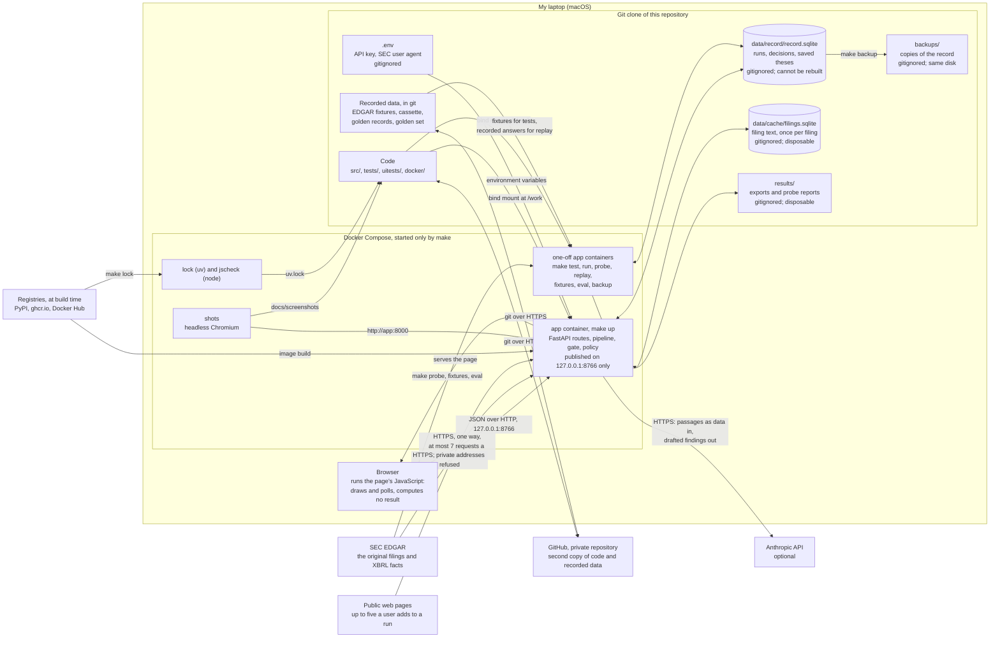

# Evidence Desk

Evidence Desk tests the claims of an investment thesis against a company's own SEC filings. It is for an equity analyst who has to decide whether a thesis still holds after a new filing: you enter a ticker, the decision and the claims; it reads the latest annual report (10-K) and the quarterly reports (10-Q) filed after it, computes the company's reported figures from its XBRL facts, and returns a verdict for each claim with the exact passages and figures behind it.

Two things are checked mechanically by the backend before anything reaches the page or the Markdown export: every quote is found word for word in a passage that was shown to the engine, and every number in a finding or in its reason is matched to one of its quotes or to a reported figure it cites. A third check is a model's: a second model, which is not shown the first one's reasoning, reads each finding's evidence and says whether it supports the statement. That is still a model's reading, of the same family as the first, so you accept or reject each finding yourself, and a second verdict follows, by the same rule, from the findings you accepted. A thesis can be saved and run again when a new filing arrives; the page then shows which verdicts moved.

It also shows what a company added, removed and reworded between its two latest annual or quarterly reports, and, under each claim of a run, which of the paragraphs that changed since the filing before share words with that claim or with the search queries the run wrote for it: a reading list for the question the tool exists for, what is new since the last filing. And it reads from a filing's own tagged facts the figures a thesis is usually about and the SEC's company-facts data does not carry: revenue by segment, by product and by geography, and each large customer's share. A run can ask to be offered those figures, so that a finding can cite them.

"Word for word" means a span of the text this tool extracted from the filing, which is not the filing byte for byte: table rows are flattened into lines, zero-width characters are removed, non-breaking and repeated spaces become one space, and a "$" or "%" printed in a cell of its own is joined to its number. A quote is located under the Item and sub-heading the parser found. In the Markdown brief a "<" inside an excerpt is escaped.

This is version 10 (tag `capstone-v10`) of the capstone. Version 8 listed, under each claim of a run, what changed in the filings ([`docs/claim-changes.md`](docs/claim-changes.md)). Version 9 read revenue by segment, product and geography and customers' shares from each filing's own tagged facts ([`docs/breakdowns.md`](docs/breakdowns.md)). Version 10 lets a finding cite those figures ([`docs/tagged-figures.md`](docs/tagged-figures.md)), answers a third hostile reading ([`docs/referee-3-triage.md`](docs/referee-3-triage.md)), and fixes three faults in the reported figures that testing on few companies had hidden ([`docs/evidence/figures-eight-companies.md`](docs/evidence/figures-eight-companies.md)). The plan and the milestones are in [`../README.md`](../README.md), the design is in [`ARCHITECTURE.md`](ARCHITECTURE.md), and the tests are described in [`docs/testing.md`](docs/testing.md).


## Run it

You need Docker running and Make. From this directory, or from the repository root:

```sh
cp .env.example .env   # optional: ANTHROPIC_API_KEY, ANTHROPIC_MODEL, SEC_USER_AGENT
make up                # http://127.0.0.1:8766
make down
```

- **Without any key** the app works on real filings: the deterministic engine quotes the sentences that best match each claim and judges no stance, so claims read "passages found, not judged". **Reported figures only** needs just a ticker.
- **With `ANTHROPIC_API_KEY`** Claude plans the retrieval queries, drafts findings with a stance and writes the summary. The same checks apply to everything it returns. This path has not run through the API since version 1 (22 October): both keys tried on 17 November were refused for lack of credit, so every model-backed result below comes from recorded answers.
- **Without the network or a key** you can still see a judged run: open <http://127.0.0.1:8766/?sample>, or run `make replay`. <http://127.0.0.1:8766/?sample=changes> shows a recorded comparison of NVIDIA's two latest annual reports, and <http://127.0.0.1:8766/?sample=breakdowns> the tagged breakdowns of the latest one. <http://127.0.0.1:8766/?sample=run-tagged> is the same thesis recorded again with the tagged figures offered to the engine. Both use three recorded NVIDIA filings and model answers replayed from a cassette ([`docs/cassettes.md`](docs/cassettes.md)).
- **With the network and no key**, `make up-recorded` starts the app with those recorded answers: **Load example**, then **Test the thesis**, gives the judged run on filings fetched live, and you can review it and save it. This works while NVIDIA's reported facts are as they were on 17 November 2026; after its next filing the prompts will no longer match the recording, and the run will fall back to the keyless engine and say so.

## What you see

1. Click **Load example** (five claims about NVIDIA) and **Test the thesis**.
2. The banner gives the status and what was read, each number with its denominator.
3. The verdicts come first, one row per claim, each naming the engine that assessed it. A legend on the page says what every mark means.
4. The reported figures follow: the newest quarter and the newest fiscal year, each figure opening to its arithmetic and the reported facts it used, with charts over time.
5. Open a claim to read its findings. Each excerpt is shown in its surrounding text with the Item of the filing it sits under and a link that opens the filing at that passage. Each finding lists its checks: the quote was found, the numbers matched, and whether its meaning was checked.
6. **Accept** or **Reject** each finding, with a note if you like. The scorecard shows two verdicts per claim: the engine's, and the one that follows from the findings you accepted. Undecided findings do not count toward yours.
7. **Save this thesis**, and later **Run again on the latest filings**. **What moved** compares the two newest runs: which verdicts changed, which excerpts are new, which filing is new.
8. **Download Markdown brief** exports the verified record, followed by the reading list of item 9, set apart; once every finding is decided, **Download reviewed brief** includes your decisions.
9. **Changed since the filing before each one this run read**, under each claim, lists the paragraphs that were added, removed, reworded or changed in their figures between each filing the run read and the filing of its form before it, when they share at least two words with the claim or with the search queries the run wrote for it: the five best by keyword overlap, each linked into its filing. The run did not read the earlier filing; it is fetched for the comparison. It is a reading list. No model chose or judged these, none counts toward the verdict, and the block is marked as a keyword match that nobody has checked.
10. **What changed in the filings** needs only a ticker. It compares the latest annual report with the one before it (or the latest quarterly report with the previous one), Item by Item: how many paragraphs are unchanged, changed only in their numbers, reworded, added and removed, with short lines and table rows counted apart. Under each Item it names the sub-headings found in only one filing and lists the paragraphs, each linked into its own filing: the added and the removed ones, the reworded ones with the changed words marked, and those whose figures alone moved with the figures marked.
11. **Segments and customers (tagged facts)** needs only a ticker too. It reads the latest annual or quarterly report's own tagged numbers into tables: revenue by business segment, by product or service and by geography, and customers' shares of revenue, each with its change from the year before and a line saying whether the members add up to the filing's tagged total. The labels are made from tag names and are not the company's own. The view reads the latest filing when asked and is tied to no run.
12. **Also offer the figures tagged in the filings**, a checkbox under Advanced, asks a run to show the engine those segment, product, geography and customer figures for the newest annual and quarterly report it read, so that a finding can cite one. They appear in the figures panel as a group of their own, and a finding that rests on figures alone, with no excerpt, says so beside its stance. It is off by default because it changes what the model is shown.


From the command line, `make run ARGS='example'` runs the same pipeline and writes `results/<run-id>.json` and `.md`; `make changes ARGS="NVDA --form 10-K"` writes the filing comparison. `make probe TICKERS="AAPL COST"` reports how well a company's filings split into their Items, and `make figures TICKERS="COST AMZN"` prints each company's quarters as a run would see them.

## The system



**Where each part runs.** Everything runs on one laptop. The served backend is one container. The page's JavaScript runs in the browser, not in the container that serves it. `make test`, `run`, `probe`, `replay`, `fixtures`, `eval` and `backup` each start a separate short-lived container from the same image; these bypass the served app, and the ones that read filings reach EDGAR themselves. Nothing listens beyond `127.0.0.1`.

**How code reaches it.** The repository is mounted into every container, so the running code is the working tree: the image holds only the dependencies, and a changed file is served without a rebuild (the page's files at once, Python code when the app is next started). `jscheck` mounts the tree read-only. The app, the one-off containers, `lock` and `shots` mount it read-write; `shots` is a third-party image (headless Chromium), and what it writes is the screenshots and the page dumps. Dependencies are installed when the image is built, from PyPI and the container registries, never while it runs. The only other copy of the code is the private GitHub repository, reached by `git push` over HTTPS.

**How data reaches it.** Filings and XBRL facts come one way from SEC EDGAR over HTTPS; nothing is written to EDGAR. A user may add up to five public pages to a run, fetched with private addresses refused. With a key, passages go to the Anthropic API as data and drafted findings come back.

**What cannot be rebuilt.** The storage is split along that line: a record that is backed up, and a cache that can be deleted.

| Data | Can it be rebuilt? | Copies |
| --- | --- | --- |
| Run records, decisions on findings, saved theses: `data/record/record.sqlite` | **No.** A run's inputs move: the facts feed changes with every filing and restatement, the list of "latest" filings moves, the parser changes, and a model does not repeat itself. A decision is a person's and exists nowhere else | The laptop, and `backups/` on the same disk (`make backup`, checked by `make restore-check`). **No copy off the laptop** |
| Filing text: `data/cache/` | Yes, from EDGAR, by the parser version that produced it | The laptop; disposable |
| The facts feed and the list of filings, as they were | No: EDGAR serves their current state | EDGAR |
| Recorded fixtures and golden records | Only as a new baseline: recording again gives different facts and moves the tripwire | Laptop and GitHub |
| The cassette of model answers | No | Laptop and GitHub |
| `results/` | Disposable. One copy; what is worth keeping is copied into `demo/` or `docs/` and committed | The laptop |
| Keys in `.env` | Yes, reissued by the provider | The laptop |

## Measured results, in brief (17 November 2026)

Every number has the command that produced it and its denominator in [`docs/results.md`](docs/results.md); outputs that are not otherwise in the repository are under [`docs/evidence/`](docs/evidence/).

| What was measured | Result | Full account |
| --- | --- | --- |
| The example thesis, recorded three times: five claims about NVIDIA, three filings (`make replay`) | First recording: complete, 18 of 18 findings verified, 18 of 18 quotes found word for word, 25 numbers checked and none unmatched. The same prompts recorded again with no reminder of the rules: again 18 of 18, 22 numbers and none unmatched, and a different verdict on one claim of five. With the tagged figures offered: 18 of 19 findings verified, one withheld for a number it did not cite | [`docs/results.md`](docs/results.md), [`demo/cassettes/`](demo/cassettes/) |
| Retrieval on the 30-case golden set (`make eval`) | The passage that must come back is among the eight shown for 9 of 24 answerable cases with the claim's own words, 18 of 24 with the planner's queries | [`docs/retrieval.md`](docs/retrieval.md) |
| Verdicts on the golden set | Agree with the expected stance in 20 of 24; no reversal; 6 of 6 unanswerable claims refused; 84 of 84 quotes found | [`eval/README.md`](eval/README.md) |
| The meaning check | Rejected 1 of 78 real findings and changed no verdict. Rejected 150 of 152 planted mismatches and accepted none | [`eval/README.md`](eval/README.md) |
| Reported figures against an answer key | 28 published values for Apple, Microsoft and NVIDIA match | [`docs/results.md`](docs/results.md) |
| Reported figures on eight companies (`make figures`) | Three faults found and fixed on 17 November: Costco's 16-week quarter was never derived, Amazon's trailing twelve months were taken for fiscal years, JPMorgan had no revenue. After each fix only that company's lines moved | [`docs/evidence/figures-eight-companies.md`](docs/evidence/figures-eight-companies.md) |
| Filings split into their Items (`make probe`) | 13 of 14 filings of eight companies; JPMorgan's quarterly report not | [`docs/results.md`](docs/results.md) |
| What changed between two filings (`make changes`) | Runs on eight companies' annual reports. NVIDIA: 251 paragraphs unchanged, 60 changed in figures only, 218 reworded, 133 added, 132 removed | [`docs/filing-changes.md`](docs/filing-changes.md) |
| Changes that bear on each claim | 802 changed paragraphs behind the example; the five best by keyword overlap listed per claim. Nobody has judged the lists | [`docs/claim-changes.md`](docs/claim-changes.md) |
| Tagged breakdowns (`make breakdowns`) | On sixteen filings of eight companies every breakdown adds up to the filing's tagged total. NVIDIA's are checked against the filing's own text | [`docs/breakdowns.md`](docs/breakdowns.md) |
| Tagged figures offered to the engine (`make replay` on two recordings made the same day) | Five verified findings cite one, and citations of figures go from 8 to 20. Not shown: that the option changes a verdict. Asking the same prompts again moved a verdict too | [`docs/tagged-figures.md`](docs/tagged-figures.md) |
| The gate from a fresh clone (`make verify-fresh`) | 1,361 offline tests, the smoke test, 142 assertions on the rendered page, in 34 s | [`docs/evidence/verify-fresh.txt`](docs/evidence/verify-fresh.txt), [`docs/testing.md`](docs/testing.md) |
| The running app, end to end, on live filings (`make live-walk`) | Passes: a judged run, decisions, the reviewed brief, a saved thesis run twice, the comparisons, the breakdowns, and a run that asks for the tagged figures and is offered 40 | [`docs/evidence/live-walk.txt`](docs/evidence/live-walk.txt) |
| Speed | One change saves a median of 28.8 ms per offline run (20 paired runs), roughly 3% of the one live run without a key that was timed. A second live run reads its filings from the cache: 0.38 s against 1.01 s | [`docs/speed.md`](docs/speed.md) |

Read all of it with three cautions. **The model answers are recordings made by stand-ins**, because the Anthropic API refused every call from this project for lack of credit: Claude Sonnet answered the engine's prompts and Claude Haiku the second model's, each as a Claude Code subagent. The first recording's stand-in was reminded to copy quotes exactly and to write no new numbers; the two later recordings and the golden set were given no reminder. One answer was recorded per prompt, and recording the same prompts again changed one verdict in five. **The golden set was drafted by a model** and no person has read it, so "agrees" means agrees with that model. And everything was measured on one laptop on one day.

## Verification

```sh
make verify         # build, lint, 1,361 offline tests, smoke test, browser-level test
make test           # offline tests only (T=tests/test_gate.py for one file)
make golden-check   # the tripwire: one recorded run, compared stage by stage
make replay         # the recorded model-backed run, offline
make uitest         # headless Chromium renders seven pages of six records; 142 assertions on the DOM
make live-walk      # the running app end to end over HTTP: needs EDGAR, no key
make eval ARGS="run --variant claim"   # score retrieval on the golden set
make backup         # copy the record to backups/; make restore-check proves it restores
make changes ARGS="NVDA --form 10-K"    # what changed between a company's two latest annual reports
make changes ARGS="AAPL --form 10-K --review 0.44"   # the same, plus the pairs to read near the threshold
make breakdowns ARGS="NVDA --form 10-K"   # segments, products, geographies and customers from the filing's tags
make figures TICKERS="COST AMZN"         # each company's quarters as a run sees them (MISSING=1 lists what has no value)
make replay ARGS='--cassette demo/cassettes/nvda-example-tagged --tagged-figures'   # the recording with tagged figures offered
make screenshots    # renders the page into docs/screenshots, for a person to look at
```

[`docs/testing.md`](docs/testing.md) names one test at each of four levels, the wrong programs each new test now fails on, the tripwire and how to read it, and what no test here can see.

## Known limitations

- **The link that opens a filing at a passage has not been checked in a browser.** It is built with a text fragment from the excerpt's first and last words. An excerpt that spans lines links by its first line; a table row links to the filing without a passage, and the page says which. A headless browser sent to sec.gov to check one link was refused as an undeclared automated tool. Click one before relying on them.
- **The Anthropic API path has not been exercised live since version 1** (22 October). The engine and the checker are tested against stub clients and through recorded answers; neither exercises the SDK call.
- **The meaning check is a second model of the same family.** It reads without the first model's reasoning, but it is not an independent party. On the golden set it withheld 1 of 78 findings and changed no verdict. Shown 152 planted mismatches (real quotes moved under a statement they do not belong to) it rejected 150 and agreed with none; that is the easy kind of mismatch, and a quote on the right topic that does not carry the statement has not been tried.
- **Retrieval decides what the engine can see.** With the planner's queries the passage that matters is among the eight shown in 18 of 24 golden cases. In the other six a claim is judged on weaker evidence, and no later check can see what retrieval left out.
- **The list of changes under a claim is a keyword match.** A changed paragraph is listed because it shares two words with the claim or with the search queries the run wrote for it and ranks among the five best by BM25. One that bears on the claim in other words is not found, and one that merely shares vocabulary is. No person and no model has judged the lists.
- **A cited figure is checked for its number, not for its relevance.** A finding may rest on reported or tagged figures alone, with no excerpt. The gate checks that the figure was offered and the number check that the statement's numbers are in it; that the figure bears on the claim is the second model's reading and yours. With the tagged figures offered, three verified findings of the recorded example are of this kind and two count as support. The page marks each one.
- **The tagged figures' labels are made from tag names** ("Wearables Homeand Accessories", "TW"), and a customer is a position in the filing's list, not a name. Outside NVIDIA's annual report the only check is that members add up to the tagged total, which would not notice a number under the wrong label. The option to offer them has been run on NVIDIA only.
- **Nothing shows that offering tagged figures changes a verdict.** One answer was recorded per prompt, and recording the same prompts again moved one verdict without the option.
- **"Complete" is not a measure of evidence.** A run is complete when every stage ran on everything it was given: every filing read, no finding withheld, every claim judged, no fallback, no time limit, and the meaning check ran. A run that asked for more filings than the company has filed since its annual report is complete too, and says in a line how many exist. A verdict in a complete run can still rest on one short quote from one filing; how many findings and filings stand behind each verdict is shown per claim, and no threshold on that is applied.
- **A quote is verified as present, not as relevant.** The quote check finds the words in a passage the engine was shown; the number check matches figures. Whether the quote bears on the statement is judged only by the second model and by you.
- **The golden set is a model's reading until a person has read it.**
- **Tables are flattened.** A table row is one line of numbers with its column headers lost, so the number check can match a figure from the wrong period, and a link cannot locate it.
- **The number check has blind spots.** It never checks a year or a fiscal label: a statement that puts a figure in fiscal 2023 passes against a quote about fiscal 2025, and putting a number in the wrong period is the commonest mistake in this kind of work. It does not check that a rise was called a rise: "fell 56%" passes against a quote that says "up 56%", because filings write most declines as a positive number with a word; only a figure printed as negative must be called a decline, by the direction word nearest it, and an amount still takes a word of decline or of an outflow anywhere in its sentence. It ignores numbers written as words and bare integers up to 12. It holds a statement to what the finding itself cites: in the recorded run with tagged figures one true sentence was withheld because the finding had not quoted the passage that holds its number. A cited figure only has to contain a matching number of the right unit; whether it is the right figure is left to the meaning check and to you.
- **The summary's wording is not checked against the verdicts.** Its numbers are; a sentence in it could call a claim supported that the table calls mixed. It is marked as model-written, beside the table it should be read against.
- **The reported figures were wrong for three of eight companies until 17 November**, each for a reason that testing on few companies had hidden: a year reported in weeks (Costco), twelve months that are not a fiscal year (Amazon), a bank's revenue concept (JPMorgan). Eight companies is still a small sample, and only 28 annual values of three of them are checked against published numbers. For a bank the cash-flow figures and the margins built on them mean little, and nothing in the tool says so.
- **Pages a user adds are fetched with the address checked at lookup, not pinned at connection.** A hostile DNS server could change its answer in between. This is a local, single-user tool; pinning is later work.
- **The record has no copy off this laptop.** `make backup` writes to the same disk, and both the record and `backups/` are ignored files inside the working tree: `git clean -fdx`, deleting the checkout or a failed disk takes the original and every backup together. `make backup-status` says how old the newest backup is and what was made since, and `make up` prints it; nothing makes a copy elsewhere. The smallest useful one is `backups/decisions-<UTC>.jsonl`, a legible file of the decisions alone. Where it goes is mine to decide.
- **Filings without Item headings over their body** (JPMorgan's 10-Q) are kept and quotable, located by sub-heading only, and a run on one is partial.
- **The page was checked by eye from screenshots** and by a DOM test, not by a user. Dark mode was not checked.
- **The filing comparison's one threshold has been read only by a model.** It was set on NVIDIA's reports. For Apple and Coca-Cola the pairs near it were read by the session that built it (`make changes ARGS="AAPL --form 10-K --review 0.44"` prints them): in risk factors it holds; in Coca-Cola's discussion of results, about three in ten pairs just above it join two different paragraphs built on one template. The other five companies' results are unread. A paragraph rewritten into several reads as one removed and several added. Table rows are counted and never shown, so a figure that moved inside a table is invisible. "An exact span" is a statement about the record: a reworded pair is drawn word by word, with its spacing normalised. What counts as a sub-heading depends on the filing's typography. Where a filing's body does not sit under its Item headings (JPMorgan), the Item named beside a change is not meaningful.
- Only 10-K and 10-Q filers. No PDFs, 8-K exhibits, foreign filers or transcripts. Runs execute in a worker thread inside the API process; there is no queue and no resume after a restart.
