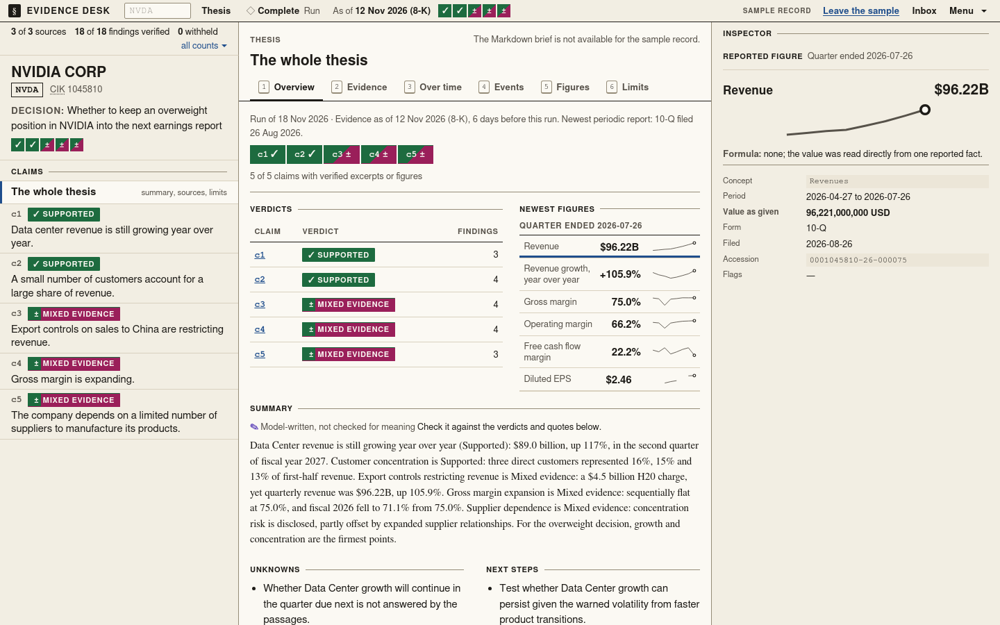

# Check-in: Evidence Desk against its plan

*Due 9 November 2026. Written 17 November 2026, eight days late. The plan is `Capstone/README.md`; the draft is due 30 November.*

**Where this stands, plainly.** There is no commit between 21 October and 17 November. Everything after the first implementation was built on 17 November in one unattended Claude Code session working from my brief: it planned each version, had Claude Opus sessions write the code, and had Claude Sonnet review each version blind before the next was built. No colleague has reviewed this work and I have reviewed no colleague's. I have not yet read every module, and I have not yet read the thirty golden cases one by one. What follows is what that session measured, with the commands that show it.

## 1. What works, shown

Each line is a command and its output at tag `capstone-v4`. The counts of tests are what pytest collects (many tests are parametrised). Outputs that are not committed are marked; the rest can be read in the repository.

| What | Command | Output |
| --- | --- | --- |
| The gate from a fresh clone | `make verify-fresh` | `805 passed`; `smoke: ok`; `33 passed` (the page) |
| A complete, judged run on three real filings, offline | `make replay` | `status: complete`; 2 claims supported, 3 mixed; `findings verified 18, withheld 0; excerpts verified 18, quotes rejected 0` |
| Reported figures against published values | `make test T=tests/test_metrics.py` | 14 fiscal-year figures for Apple, Microsoft and NVIDIA match the annual reports exactly |
| Filings of eight companies split into their Items | `make probe TICKERS="NVDA AAPL MSFT KO JPM TSLA COST AMZN"` | 13 of 14 filings segmented (95.8% to 99.4% of text under an Item); JPMorgan's 10-Q not (1.6%). Committed as `docs/speed/probe-v4.md` |
| Retrieval, measured | `make eval ARGS="run --variant claim"` | recall@8 29.2% (7 of 24); recall@20 54.2% (13 of 24). Committed under `eval/results/`. Not offline from a fresh clone: the filings of four companies are fetched from EDGAR into `eval/cache` first (`make eval ARGS="fetch"`). This measurement belongs to milestone 5 and was started early |
| The running app, end to end, on live filings | `make live-walk` | `complete; 3 of 3 filings from live EDGAR; 18 of 18 findings verified; 0 engine fallback(s)` ... `No verdict moved and no filing is new.` ... `live walk: PASS`. Output not committed. **This line expires**: the recorded answers match only until NVIDIA's next filing, after which the walk fails by design and the cassette has to be recorded again |
| A reviewer's decisions survive a restore | `make backup && make restore-check` | `PASS: ... restores to the live record` on the record the live walk had just written. Output not committed (`backups/` is ignored). Same disk, same machine; a restore into a running app is not tested |

## 2. What failed, the evidence, and what I changed

- **The schedule.** Four weeks without a commit, then one day. The cost is in the first paragraph: no colleague review in either direction, and code I have not read. What I changed is only that it is written down here and in each hand-in.
- **The first idea had no reader.** Review 1 could not say who the tool was for or how anyone would know it worked. I asked for a real financial research tool, and the session narrowed the project from "any research question on the web" to "an investment thesis against a company's SEC filings", where the text is fixed and the numbers have published values. That narrowing is the largest decision made on my behalf, and it is mine to confirm.
- **The model could not be called.** Both API keys were refused for lack of credit. Model answers are instead recorded: the engine's exact prompts were answered by Claude Sonnet as a Claude Code subagent and replayed from a cassette. Evidence: `demo/cassettes/nvda-example/README.md`. Consequence: the API path has not run live since 22 October, and the recorded quote rate is an upper bound.
- **Three true findings were withheld.** The first recorded run verified 15 of 18: the model copied "Compute &amp;amp; Networking" from the prompt's escaped text. An engine bug; fixed with a test; 18 of 18 on the same recording.
- **The parser was tested on one company.** `make probe` on seven others found three layout faults (Costco, Microsoft, JPMorgan). Two fixed; one documented.
- **Two rules the brief stated about the figures were wrong on real data.** "Exactly equal" (a rounding difference of USD 1 million) and "the latest filing wins" (restated annual revenue at Microsoft broke the fourth-quarter derivation).
- **A speed claim did not hold up.** Version 3 reported an 8% gain; review 3 showed the numbers did not reconcile and that the profile was of the offline run, which is not where a real run's time goes. Re-measured over 20 alternating pairs, the change saves a median of 28.8 ms per offline run (faster in 18 of 20), which is 7 to 9% offline and about 3% of a live run without a key. (This said "under 1%" until the second referee set it beside `docs/speed.md`.) The saving that matters is the filing cache: a second live run took 0.38 s against 1.01 s.
- **Retrieval is poor on paraphrased claims.** 7 of 24. The passage is usually in the filings read and not in the eight passages shown to the engine. This is the largest open problem in the project.
- **The golden set is a model's reading.** Its thirty cases and their expected stances were drafted by a model from the filing text and checked mechanically. Until I have read them, the retrieval numbers measure agreement with that model, not with an answer key.
- **A key was pasted into a conversation.** One of the two API keys in `.env` went into an agent session in plain text. It has to be rotated; I have not done that yet.
- **Something on this laptop listens on all interfaces.** Writing down the open ports found a container on `*:8088` that is not this project's. I do not yet know what it is.

## 3. What I am cutting, and what the draft still claims

The cuts below were proposed by the session from what the measurements showed. Each is mine to confirm.

**Cut:**

- The open-web question mode and web search (removed in version 2; never tested live).
- PDFs, 8-K exhibits, earnings-call transcripts, foreign filers.
- Filings with no Item headings over their body (JPMorgan's 10-Q): kept and quotable, not segmented.
- Vector embeddings for retrieval. The next version tries model-written queries and reranking first, because they need no new dependency and the golden set can say whether they are enough.
- Any hosted deployment. The app stays on `127.0.0.1`.
- At risk: milestone 6, what changed between two filings. If it is cut, the draft claims only the comparison between two runs of a saved thesis.
- Milestone 5 is partly done at this tag: retrieval is measured for one variant. Its other two exit checks, a second-model check of meaning and the refusal of unanswerable claims, are not met yet and are not cut.

**The draft still claims:**

1. Every excerpt shown is an exact span of the stored filing, and every number in a finding is in its quotes or its cited figures.
2. A verdict follows by a fixed rule from the findings that passed those checks, and a second verdict follows by the same rule from the findings the reader accepted.
3. The reported figures reproduce published values for three companies.
4. Retrieval is measured on a golden set, and the number is reported whatever it is.

**The draft does not claim** that a "Supported" verdict is correct. Nothing yet checks whether a quote means what a finding says.

## 4. One shortcut to throw away, one part to keep

**Throw away:** the stand-in channel for model answers. A cassette answered by a subagent that was reminded of the engine's rules is a way to keep working without credit, not a measurement. When the API can be called, the cassettes are recorded again through it and the quote rate is measured without the reminder.

**Keep, and so test and document:** the gate (the quote check and the number check) and the tripwire. Everything else in the project can be wrong and the page will still not show a quote that is not in the filing. They have the densest tests (`tests/test_gate.py`, `tests/test_numcheck.py`, `tests/test_golden.py`) and their own section in `docs/testing.md`.
