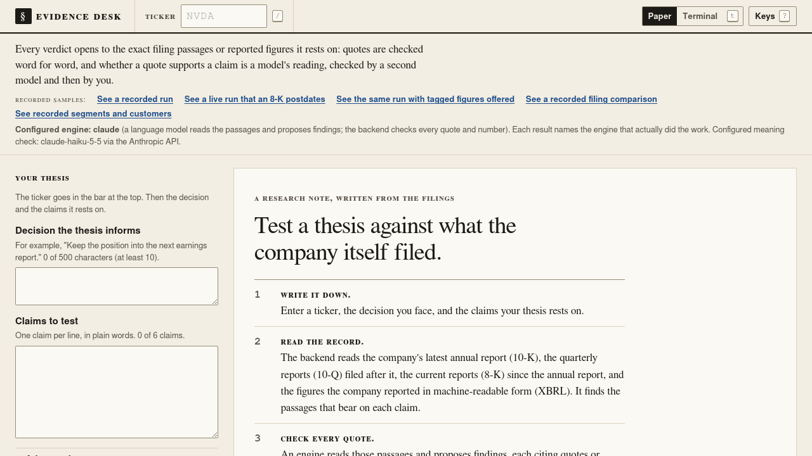

# W5L2: Evidence Desk — the version that answers the structure review

**Lecture date:** October 21, 2026

**GitHub repository:** [EE292M](https://github.com/abgup05/EE292M)

**Version:** tag `capstone-v2` (the version reviewed was `capstone-v1`)

**Plan and prompt:** `Capstone/README.md`, `Capstone/PROMPT.md`

**How AI was used.** A Claude Code session ran this sprint unattended from my brief. It planned the version, wrote the shared contracts, had four Claude Opus sessions write the modules in parallel and a fifth integrate them, and checked the result. I set the direction (make this a real financial research tool). The decisions recorded here were made in that session and are mine to check; I have not yet read every module.

## 1. The messaging

Review 1 could not fill "who decides" or "we will know because" from my README. Both READMEs now open with the full sentence:

> For an equity analyst who has to decide whether a thesis still holds after a new filing, Evidence Desk tests each claim in the thesis against the company's own SEC filings and reported numbers, and we will know it works because every verdict opens to an exact filing passage and a golden set of questions with known passages measures how often the right one is retrieved and cited.

The second half of that sentence is a promise, not a result. This version has the passages; the golden set is milestone 5.

To fill the first slot honestly I narrowed the project. The first version took any question and any web page, and I am not the user of that tool. I am interested in equity research, where a thesis is a short list of claims and the place to check them is the company's filings. The new version takes a ticker, a decision and one to six claims, reads the latest 10-K and the 10-Qs after it from SEC EDGAR, and returns a verdict per claim with the passages behind it. The agent proposed this narrowing from my second pitch (the thesis change tracker). It is the largest decision in this hand-in, and it is mine to confirm.

The first screen, against the four questions from the lecture:

| Question | In this version |
| --- | --- |
| The message first | One sentence before any control: "Test each claim in your thesis against the company's own SEC filings. Every verdict opens to the exact passage." After a run, the verdicts come before any detail |
| One meaning per mark | Each verdict and each stance has its own glyph and label, so identity does not rest on colour |
| Units and denominators | "3 of 3 sources read", "15 quotes verified, 0 rejected"; the filing date and the UTC retrieval time are separate, labelled columns |
| The next reader | 10-K is glossed as "annual report" and 10-Q as "quarterly report"; CIK and accession numbers carry a tooltip |

## 2. The organization: one job per module, one pipeline

The layout is now a pure core with adapters around it, as in the colour-space tool from the lecture:

- `core/` holds no network and no files: the records (`models.py`), every number in the contract (`limits.py`), the verdict and status rules and their wording (`policy.py`), the interfaces (`ports.py`), the quote gate (`gate.py`).
- `sources/` has one adapter per outside system: `edgar.py` and `filing.py` for SEC filings, `http.py` and `web.py` for an ordinary public page. Both return the same `Document`.
- `retrieval/` chunks documents into passages and ranks them. `engines/` holds the interchangeable analysis engines.
- `services/thesis_run.py` is the one pipeline. The HTTP API and the command line both call it, so they cannot drift.

The three likely changes from Monday's hands-on now have one place each: a new source format is a new adapter in `sources/`; a change to the verdict or status rule is `core/policy.py`; a new output view reads the record and takes its wording from `GET /api/meta`.

## 3. The design patterns and interfaces, named

| Pattern | Where | The one interface it talks through |
| --- | --- | --- |
| Ports and adapters | `core/ports.py`; `sources/edgar.py`, `sources/http.py` | `FilingSource`, `PageFetcher` |
| Strategy | `engines/extractive.py`, `engines/claude.py` | `Analyst` (planner, assessor, summarizer) |
| Decorator | `engines/fallback.py` wraps any engine and falls back on failure | `Analyst` |
| Gate | `core/gate.py` | `gate_claim` in, verified findings out |
| Repository | `store.py` | `Store` |
| Composition root | `wiring.py`, the only module that reads the environment | functions that build collaborators |
| Pipeline with two entry points | `services/thesis_run.py`, called by `api.py` and `cli.py` | `execute_run` |

`ARCHITECTURE.md` has the same table with a "where a change goes" section.

## 4. Each finding from review 1

| Finding | Built in |
| --- | --- |
| F1: status rule and limits in five files | `core/limits.py` and `core/policy.py`; the page and the export take their wording from the API |
| F2: `api.py` wires backends and opens a database at import | `wiring.py`; `api.py` is built by a factory and holds routes |
| F3: record types import URL policy | `core/models.py` imports only `limits`; URL safety is checked in `api.py` |
| F4: retrieve step does eight jobs; fallback hard-coded twice | `services/ingest.py`; `engines/fallback.py` |
| F6: interfaces inside the pipeline; one protocol, two jobs | `core/ports.py`; `Planner`, `Assessor`, `Summarizer` |
| F7: raw `"failed"` string, no finish time | `thesis_run.fail_run` is the only way to fail a run |
| F8: status wording duplicated | `GET /api/meta` |
| F9: no success measure in the README | The opening sentence above |

Answered in one line of `Capstone/README.md`, with the reason, instead of built as written: F5 (a content-type registry) and F10 (a `kind` field for the extractive engine).

## 5. What the version does, measured

`make verify` is green: lint, 385 offline tests, a smoke test of the running container. The live demonstration (`demo/demo-2026-11-17-v2.md`) read 3 of 3 NVIDIA filings from EDGAR, indexed 636 passages, and verified 15 of 15 quotes as exact spans of the stored text, in 3.2 seconds.

What it did not do: judge anything. Every model call was refused with "credit balance is too low", so all seven engine steps fell back to the deterministic engine and all five claims read "passages found, not judged". The run is marked partial and says why. **The model-backed path was not exercised live in this version.**

Two more things I did not expect:

- A probe of seven other companies' latest filings found that Costco's 10-K is not split into Items at all (its headings use a dash where the parser expects a full stop) and that JPMorgan's filings land almost entirely under "Cover page". The parser's tests only ever saw NVIDIA.
- The page had never been opened in a browser when the code was "done". I added `make screenshots` (headless Chromium) and looked at three images before tagging.

## 6. Work log

See `Work Logs/Week 5/W5L2WL.md`.

## 7. Feedback on today

"Give every mark one meaning" is the rule this project broke without noticing: the next review found one mark, a dashed border, standing for seven different things. "State the idea first" reshaped the result screen, which now opens with the verdicts. The contract example in the slides returns its answer on the success path only, and every bug in this version was on the other path: what a count means when the step before it has failed. One slide on writing the failure case into the interface would have been worth more here than any other.
