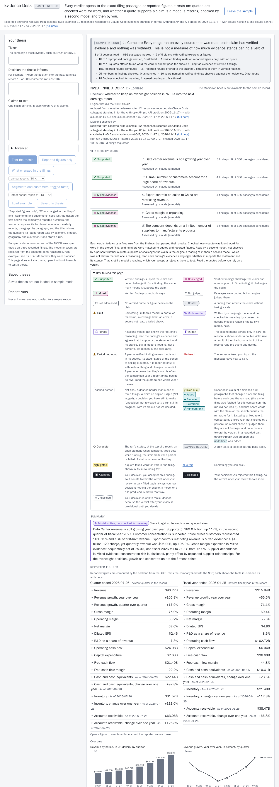

# W6L2: Evidence Desk — the version that answers the message, interface and tests review

**Lecture date:** October 28, 2026

**Handed in:** November 17, 2026 (late; the catch-up is described in `Capstone/evidence_desk/docs/check-in.md`)

**GitHub repository:** [EE292M](https://github.com/abgup05/EE292M)

**Version:** tag `capstone-v3` (the version reviewed was `capstone-v2`)

**How AI was used.** A Claude Code session ran this sprint unattended from my brief. It had Claude Opus sessions write the modules and Claude Sonnet review the previous version blind. Because the Anthropic API refused every call for lack of credit, the model answers in the recorded run below were produced by Claude Sonnet as a Claude Code subagent answering the engine's exact prompts; `demo/cassettes/nvda-example/README.md` says how. The decisions recorded here were made in that session and are mine to check.

## 1. The message and the interface: each finding

| Finding from review 2 | What changed |
| --- | --- |
| F1: the page says a verdict is "computed from quotes checked word for word", when only the quote is checked | The first screen and a note under the verdicts now separate what is checked (every quote, every number) from what is not (whether the quote supports the claim, which is the engine's reading). A deterministic number check is built: section 2 |
| F2: the sample shows no verdict and one error seven times | The sample is now a recorded model-backed run: two claims supported, three mixed. A repeated engine failure is reported once, with the steps it hit |
| F3: the engine named is not the engine that ran | The record carries which engine assessed each claim, how many steps fell back, and where the answers came from. The count reads "claims with verified excerpts or figures" |
| F4, F5: amber, ▲ and dashed borders each mean several things | One meaning per mark, with a legend on the page: amber ▲ only for something that limits the record; violet ✎ only for model-written text; red only for rejected input; a dashed border only for "not judged" |
| F6: the model-written label depends on a regular expression | Exact comparison against the record; every model-written field is badged |
| F7: numbers without denominators | "8 of 636 passages considered", "18 of 18 proposed findings verified" |

## 2. The tests the reviewer asked for, written and green

`make verify` passes from a fresh clone of the tag: 708 offline tests, the smoke test, and 25 assertions on the rendered page.

**The wrong programs.** Each of the reviewer's five, and the sixth I listed, now fails a named test. Each test was seen failing by planting the wrong program and then removing it:

| Wrong program | The test that fails on it | How it failed when planted |
| --- | --- | --- |
| `PASSAGES_PER_CLAIM` 8 → 2 | `test_golden.py`, `test_limits_contract.py` | The tripwire named the stage "limits"; the contract test reported `(2, 8)` |
| "Prefer findings that support the claim" added to the prompt | `test_golden.py`, `test_replay.py` | The tripwire named "prompts"; the replay reported five requests with no recorded answer |
| An excerpt's locator taken from the wrong passage | `test_golden.py`, `test_thesis_run.py` | The tripwire named "evidence"; the locator test compares each locator with the section that contains the excerpt's offset |
| ✓ and ✕ swapped in the page | `uitests/test_dom.py` | The assertion on that verdict's glyph failed |
| The older of two annual reports selected | `test_edgar.py` | The selection test on an index with two 10-Ks and an amendment failed |
| "Revenue grew 65%" above a quote that says 56% | `test_numcheck.py`, `test_thesis_run.py` | The finding is withheld with the reason "a number in the statement is not in its quotes or cited figures: 65%" |

**The tripwire.** `tests/golden/golden.json` is one recorded run of the example on three recorded filings with the deterministic engine: per source its section count and content hash; the limits; a hash of each prompt; per claim the passages offered, in order; per excerpt its offset and hash; the verdicts, the counts, the figures; and one SHA-256 over all of it. `make golden-check` compares stage by stage and names the first stage that moved. `make golden-baseline` writes a new record, and its help line says to read the diff first.

**The answer key.** The reported figures are new in this version, and they are the part of the project that has published values to be checked against:

- **Known values.** Fiscal-year revenue and net income for Apple (2022 to 2024), Microsoft (2023, 2024) and NVIDIA (2024, 2025), fourteen figures entered by hand in USD millions, and the growth rates that follow from them (Apple −2.8% and +2.0%, NVIDIA +114.2%). All fourteen match the recorded XBRL data exactly. The builder was told that if one did not match, it must not edit the expected number but go and read the filing.
- **Independent method.** Wherever a company reported a quarter and the year-to-date totals around it, the differenced value must equal the reported one. And the newest quarter's revenue from the XBRL facts must appear, in USD millions, in the text of the 10-Q for that quarter: two separate paths to one number.
- **Identities.** Revenue minus cost of revenue equals gross profit; the four quarters of a year sum to the year; free cash flow is operating cash flow minus capital expenditure.

**A second filer** (F11). Costco's 10-K is now a full-size fixture. Getting it to parse found three faults that NVIDIA's filings had hidden.

**Real model answers, replayed** (F9). `test_replay.py` runs the example with the seven recorded answers and asserts each claim's verdict and counts. If a prompt changes, the recorded answers no longer match and the test fails.

**The page** (F8). `make uitest` renders two records in headless Chromium and asserts on the DOM: each verdict's label, glyph and class; every banner count against its field; every excerpt inside a highlight; model badges only on model-written fields.

## 3. Time and limits

- The timing assertion that depended on the machine is now a scaling check: a text eight times as long must take less than twenty times as long (a quadratic version, planted, took 33.6 times).
- The demo test asserts facts in the Markdown, not whole formatted lines.
- **Kept as it was** (one line in `Capstone/README.md`): the API tests still run against a fake EDGAR. It serves recorded real filings, and the live path stays outside the gate.
- `docs/testing.md` lists what no test here can see. The first item is unchanged from the review: whether a highlighted quote actually supports the claim.

## 4. What the real data did that the plan had not expected

- **A quote copied "Compute &amp;amp; Networking".** The engine escapes `&` when it shows a passage to the model; the model copied the escaped form; the gate could not find it in the filing. The first recorded run verified 15 of 18 findings for that reason alone. Fixed in the engine, test first; the same recording now verifies 18 of 18.
- **Rounding.** NVIDIA reports a quarter as 96,221 (USD millions) while its half-year total minus its first quarter gives 96,222. "Exactly equal" had to become "within one million", for that one quarter by name.
- **Restatements.** "The latest filing wins" broke the fourth-quarter derivation: Microsoft restated two years of annual revenue but never the nine-month figures, so annual minus nine months gave a wrong quarter. A derived quarter now uses the latest pair of reports that agree with each other.
- **A stock split.** NVIDIA's older annual EPS was restated from 11.93 to 1.19.
- **Tables carry no scale.** The 10-Q prints "Revenue $ 96,221". The number check has to accept a table number at the scale of thousands, millions or billions.
- **Three filing layouts** the parser did not handle (Costco, Microsoft, JPMorgan), found by `make probe` on eight companies. Two are fixed; JPMorgan's 10-Q has no Item headings over its body and is reported as not segmented.

## 5. The hands-on: profile, review, measure one change

- **Profile** (`make profile`, `docs/speed.md`). The offline example takes 0.44 s. Parsing three filings is 66% of it, almost all inside the HTML library; retrieval is 6%.
- **One change, measured.** The parser built and then discarded the inline-XBRL header, 14 to 17% of each filing's tags. Cutting it before parsing took the median of five runs from 0.445 s to 0.411 s, about 8%. The tripwire's hash was the same before and after, so no answer changed.
- **A second change, measured with a stand-in.** Claims are now assessed three at a time. With an engine that waits 200 ms per call, five claims take 0.50 s against 1.13 s. The real model could not be called, so the real gain is unknown.
- **Not done.** I did not run the course's `/speed-review` skill: its `SKILL.md` is not in this repository. The profile was read directly.

## 6. The result, measured

The recorded run (`make replay`, record in `demo/recorded-run-v3.md`): status complete; 3 of 3 filings; 18 of 18 proposed findings verified; 18 of 18 quotes found word for word; 25 numbers checked, none unmatched; 156 reported figures computed. The quote rate is an upper bound, because the instructions around the recorded prompts repeated the rule about exact quotes.

Still true: the Anthropic API path has not been exercised live since version 1, and nothing checks whether a quote means what a finding says.

## 7. Work log

See `Work Logs/Week 6/W6L2WL.md`, which lists what changed finding by finding.

## 8. Feedback on today

*A draft by the Claude Code session that did the catch-up, written on 17 November from the slides and from applying this session's material that day. It was not at the lecture. Mine to rewrite, with what I thought in the room, before anything goes on the companion site.*

"Measure first" and "delete before you tune" both held: retrieval, the part that looked worth tuning, was 6% of the run, and the one change that helped removed work. The mistake that followed was against the slide, not for want of it: it asks for a median with its spread, version 3 reported a single figure, and the next review showed the figure did not add up. One addition to the hands-on would have helped. It has you profile an input that runs in under a minute; for this tool that was the offline run, which is not where a real run spends its time.
